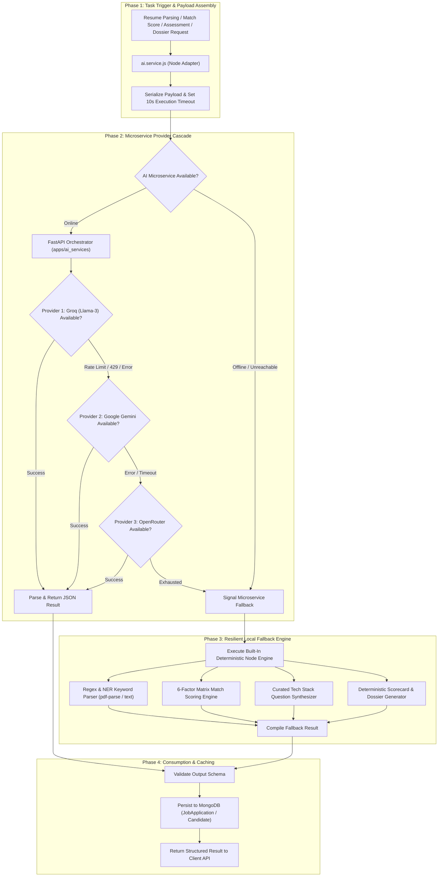

# AI Evaluation Pipeline & Multi-Provider Fallback Architecture

## 1. Overview

The **AI Pipeline Workflow** powers ThinkWires' automated recruitment intelligence. It coordinates between the Node.js Express backend (`apps/backend`) and the Python FastAPI AI microservice (`apps/ai_services`), providing resume parsing, job match scoring, dynamic technical assessment generation, and candidate dossier evaluation.

To ensure high availability in production, the pipeline operates a **multi-provider LLM cascade with deterministic local fallback**, ensuring that operations continue even during external API downtime or rate-limit throttling.

---

## 2. End-to-End Workflow Architecture



---

## 3. Core AI Capabilities & Pipeline Engines

### 1. Resume Binary Extraction & NER Parsing
* **Endpoint**: `POST /api/candidate/parse-resume`
* **Microservice Route**: `POST /api/parser/parse`
* **Local Fallback**: `fallbackParseResume()` using `pdf-parse`
* **Execution Mechanics**:
  - Extracts text from uploaded PDF/DOCX buffers.
  - Applies Named Entity Recognition (NER) to extract candidate name, email, phone, location, LinkedIn/GitHub links, and current job title.
  - Matches technical skills against a comprehensive catalog of 300+ technology keywords.

---

### 2. Candidate-to-Job Match Scoring
* **Service Method**: `aiService.calculateMatchScore()`
* **Microservice Route**: `POST /api/screening/calculate-match-score`
* **Local Fallback**: `fallbackCalculateMatchScore()`
* **Execution Mechanics**:
  - Compares candidate skills, experience years, and career summary against target Job Description requirements.
  - Outputs:
    - `fit_score` ($0 - 100$)
    - `skills_match_score` and `experience_match_score`
    - `matched_skills` vs. `missing_skills`
    - `fit_badge`: `'Top Match'` ($\ge 80$), `'Moderate Match'` ($65 - 79$), or `'Below Threshold'` ($< 65$).

---

### 3. Dynamic Technical Assessment Generator
* **Service Method**: `aiService.generateAssessment()`
* **Microservice Route**: `POST /api/screening/generate-assessment`
* **Local Fallback**: `fallbackGenerateAssessment()`
* **Execution Mechanics**:
  - Analyzes the job opening's required stack (e.g., *React, Node.js, PostgreSQL, Docker*).
  - Synthesizes 5 role-specific technical multiple-choice and scenario questions.
  - Configures test parameters: 100 total points, 75 passing threshold, and 20-minute time limit.
  - Saves the generated question payload into `JobApplication.assessment`.

---

### 4. Interactive Assessment Evaluation Engine
* **Service Method**: `aiService.evaluateAssessment()`
* **Microservice Route**: `POST /api/screening/evaluate-assessment`
* **Local Fallback**: `fallbackEvaluateAssessment()`
* **Execution Mechanics**:
  - Evaluates candidate answers submitted against the assessment.
  - Computes final points, pass/fail decision, and assigns `gatekeeper_status` (`'Passed'` or `'Failed'`).
  - Promotes candidate vetting score upon passing.

---

### 5. Candidate Evaluation Dossier Synthesis
* **Service Method**: `aiService.evaluateCandidate()`
* **Microservice Route**: `POST /api/screening/evaluate-candidate`
* **Local Fallback**: `fallbackEvaluateCandidate()`
* **Execution Mechanics**:
  - Compiles the complete 6-factor recruitment appraisal:
    1. Mandatory Skills Match (35%)
    2. Role & Responsibilities Match (25%)
    3. Experience & Seniority Tier (15%)
    4. Notice Period Alignment (10%)
    5. Compensation Fit (10%)
    6. Cultural & Delivery Dynamics (5%)
  - Generates the executive summary, engineering strengths, gaps, and requirement alignment matrix.

---

## 4. Multi-Provider Fallback Cascade Architecture

The AI service maintains a layered fallback hierarchy:

```
┌────────────────────────────────────────────────────────┐
│               Primary: Groq (Llama-3-70b)             │  Sub-second inference speed
└──────────────────────────┬─────────────────────────────┘
                           │ (On Rate Limit / 429)
┌──────────────────────────▼─────────────────────────────┐
│               Secondary: Google Gemini 1.5             │  High-capacity multimodal
└──────────────────────────┬─────────────────────────────┘
                           │ (On Quota / Timeout)
┌──────────────────────────▼─────────────────────────────┐
│               Tertiary: OpenRouter Gateway             │  Aggregated cloud model routing
└──────────────────────────┬─────────────────────────────┘
                           │ (On Network / Service Drop)
┌──────────────────────────▼─────────────────────────────┐
│          Local Deterministic 6-Factor Engine           │  Zero-latency internal Node fallback
└────────────────────────────────────────────────────────┘
```

### Fallback Guarantees:
- **Zero Request Failures**: If external AI APIs drop or take longer than 10 seconds, the Node adapter aborts the network request (`AbortSignal.timeout(10000)`) and immediately executes local heuristic engines.
- **Consistent Schema**: All fallback methods return the exact same JSON schema as the AI microservice, ensuring that the frontend UI and database drivers operate without errors.

