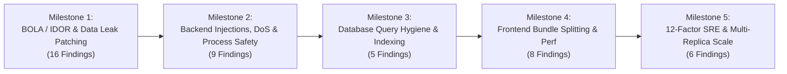

# Master Audit Implementation Tracker & GitHub Milestones

This document is the centralized implementation and verification tracker translating all security, architecture, performance, and SRE audit findings across Thinkwires into structured development milestones, actionable tasks, and acceptance criteria.

---

## 1. Roadmap & Milestones Overview

| Milestone | Target Scope | Findings Covered | Target Completion | Status |
| :--- | :--- | :---: | :---: | :---: |
| **Milestone 1: BOLA / IDOR Remediation** | Candidate & Admin route authorization, PII defense, file access control | BOLA 1–16 | Sprint 7 | **Ready for Dev** |
| **Milestone 2: Express Hardening & Process Safety** | NoSQL query injection, mass assignment, 10MB DoS, unhandled rejections | SEC-EXP 01–09 | Sprint 7 | **Ready for Dev** |
| **Milestone 3: Database Query Hygiene & ESR Indexing** | Unbounded `.find()`, compound ESR indexes, schema strictness, migrations | SEC-DB 01–05 | Sprint 8 | **Ready for Dev** |
| **Milestone 4: Frontend Code-Splitting & Client Security** | React.lazy, Three.js deferral, search debouncing, AbortController, cookie auth | SEC-FE 01–08 | Sprint 8 | **Ready for Dev** |
| **Milestone 5: 12-Factor Portability & SRE Readiness** | S3/R2 object storage, 0.0.0.0 binding, /healthz vs /ready probes, graceful drain | DEP 01–06 | Sprint 9 | **Ready for Dev** |

---

## 2. Milestone 1: BOLA / IDOR & Data Protection (16 Issues)

*Reference Document: [`docs/BOLA_IDOR_Remediation_Plan.md`](BOLA_IDOR_Remediation_Plan.md)*

| Issue Key | Severity | Target Endpoint & File | Vulnerability Summary | Remediation Required |
| :--- | :---: | :--- | :--- | :--- |
| **BOLA-1** | **CRITICAL** | `POST /api/candidate/apply` `apps/backend/src/controllers/candidatePortal.controller.js` | Cross-user PII leak on HTTP 409 conflict dump | Remove victim application and dossier payload from 409 response; return generic error message. |
| **BOLA-2** | **HIGH** | `POST /api/candidate/apply` `apps/backend/src/controllers/candidatePortal.controller.js` | Arbitrary resume pointer attachment | Validate that `resumeUrl` belongs strictly to the authenticated candidate before persisting. |
| **BOLA-3** | **HIGH** | `GET /api/candidate/resumes/:filename` `apps/backend/src/controllers/candidatePortal.controller.js` | Predictable resume filename download & path traversal | Enforce candidate ownership check and sanitize filename against path traversal (`..`, `/`). |
| **BOLA-4** | **HIGH** | `POST /api/candidate/avatar` `apps/backend/src/controllers/candidatePortal.controller.js` | Avatar overwrite & path traversal | Sanitize filename, restrict upload to validated image MIME types, and scope to candidate ID. |
| **BOLA-5** | **HIGH** | `DELETE /api/admin/jobs/:id` `apps/backend/src/controllers/admin.controller.js` | CMS admin deleting active recruiter job requirements | Restrict job deletion to `superadmin` and `admin` roles; forbid `cms_admin`. |
| **BOLA-6** | **HIGH** | `DELETE /api/admin/candidates/:id` `apps/backend/src/controllers/admin.controller.js` | CMS admin purging candidate ATS records | Restrict candidate deletion strictly to `superadmin` and ATS `admin`. |
| **BOLA-7** | **HIGH** | `GET /api/bench/:id` `apps/backend/src/controllers/candidatePortal.controller.js` | Unredacted candidate dossier exposure on public bench | Run candidate dossier through `sanitizeDossierForBench()` before returning to public client. |
| **BOLA-8** | **HIGH** | `GET/POST /api/candidate/timesheets/:id` `apps/backend/src/controllers/candidatePortal.controller.js` | Timesheet IDOR across candidates | Scope queries with `{ _id: id, candidateId: req.user._id }`. |
| **BOLA-9** | **MEDIUM** | `PUT /api/admin/requisitions/:id` `apps/backend/src/controllers/admin.controller.js` | Cross-tenant mandate modification | Validate tenant ownership and require elevated recruiter privileges. |
| **BOLA-10** | **MEDIUM** | `POST /api/bench/:id/reserve` `apps/backend/src/controllers/candidatePortal.controller.js` | Bench reservation status tampering | Prevent direct status manipulation; transition through validated reservation state machine. |
| **BOLA-11** | **MEDIUM** | `GET /api/admin/placements/:id` `apps/backend/src/controllers/admin.controller.js` | Exfiltration of client billing margins | Redact client bill rate and gross margin for non-finance admin roles. |
| **BOLA-12** | **MEDIUM** | `PUT /api/admin/system-members/:id/role` `apps/backend/src/controllers/admin.controller.js` | Unrestricted role escalation | Require `superadmin` role to mutate any administrative user privileges. |
| **BOLA-13** | **MEDIUM** | `POST /api/candidate/avatar/preset` `apps/backend/src/controllers/candidatePortal.controller.js` | Arbitrary preset identifier injection | Whitelist allowed avatar preset IDs against a strict enum. |
| **BOLA-14** | **MEDIUM** | `POST /api/admin/auth/logout` `apps/backend/src/controllers/auth.controller.js` | Incomplete cookie clearance on logout | Explicitly clear cookie with exact matching domain, path, and security flags. |
| **BOLA-15** | **MEDIUM** | Global `:id` Route Handlers `apps/backend/src/middlewares/validateId.middleware.js` | Mongoose `CastError` 500 crash on malformed ObjectId | Implement ObjectId validation middleware returning 400 Bad Request on invalid IDs. |
| **BOLA-16** | **HIGH** | `apps/backend/src/models/jobApplication.mongo.model.js` | Index collision blocking candidate re-applications (#208) | Replace compound unique index with partial unique index filtering active applications only. |

---

## 3. Milestone 2: Express Backend Hardening & Process Safety (9 Issues)

*Reference Document: [`docs/ExpressBackendSecurityAndArchitectureAudit.md`](ExpressBackendSecurityAndArchitectureAudit.md)*

| Issue Key | Severity | Target Endpoint & File | Vulnerability Summary | Remediation Required |
| :--- | :---: | :--- | :--- | :--- |
| **SEC-EXP-01** | **CRITICAL** | `apps/backend/src/controllers/admin.controller.js:672, 1336` | NoSQL query selector injection via `req.query` | Sanitize and whitelist all query filters using string primitives; reject objects with `$` prefix. |
| **SEC-EXP-02** | **HIGH** | `apps/backend/src/controllers/admin.controller.js:1437-1452` | Mass assignment via raw `req.body` in `findOneAndUpdate` | Whitelist editable attributes using an explicit DTO schema before database persistence. |
| **SEC-EXP-03** | **HIGH** | `apps/backend/src/app.js:64-65` | Excessive JSON body parser limit (10MB) | Lower `express.json({ limit: '1mb' })`; configure dedicated multer streaming for file uploads. |
| **SEC-EXP-04** | **HIGH** | `apps/backend/src/app.js:168-177` | Stack trace and error message leakage in production | Mask internal database error details in 500 responses when `NODE_ENV === 'production'`. |
| **SEC-EXP-05** | **HIGH** | `apps/backend/src/server.js:68-96` | Missing `unhandledRejection` and `uncaughtException` monitors | Register process-level exception handlers with structured logging and graceful shutdown. |
| **SEC-EXP-06** | **HIGH** | `apps/backend/src/routes/api.route.js:455-474` | Privilege escalation in `POST /api/openings` | Remove `cms_admin` from allowed roles in requisition publishing routes. |
| **SEC-EXP-07** | **HIGH** | `apps/backend/src/configs/db.js:42` | PostgreSQL TLS verification bypass (`rejectUnauthorized: false`) | Enforce strict CA certificate verification in production environments. |
| **SEC-EXP-08** | **HIGH** | `apps/backend/src/models/job.mongo.model.js:142` | `strict: false` schema bypass | Set `strict: true` and define complete attribute schemas for Job and Article models. |
| **SEC-EXP-09** | **MEDIUM** | `apps/backend/src/configs/mongodb.js:28` | Production index synchronization missing | Create an automated startup index verification and migration script. |

---

## 4. Milestone 3: Database Query Hygiene & ESR Indexing (5 Issues)

*Reference Document: [`docs/DatabaseSecurityAndQueryAudit.md`](DatabaseSecurityAndQueryAudit.md)*

| Issue Key | Severity | Target Scope | Problem Statement | Remediation Required |
| :--- | :---: | :--- | :--- | :--- |
| **SEC-DB-01** | **HIGH** | 19 Unbounded `.find()` queries across admin controllers | Unconstrained queries threaten V8 heap exhaustion (OOM) | Enforce pagination with default `.limit(50)` and max `.limit(100)` across all list endpoints. |
| **SEC-DB-02** | **HIGH** | 8 Mongoose Models | Missing compound Equality-Sort-Range (ESR) indexes | Add compound ESR indexes for `status`, `createdAt`, `jobId`, and `email` across models. |
| **SEC-DB-03** | **MEDIUM** | PostgreSQL Migrations | Schema changes executed via `sync()` rather than migrations | Establish migration runner with forward/backward migration files for all relational schemas. |
| **SEC-DB-04** | **MEDIUM** | Mongoose Schema Hygiene | Schemas lacking timestamp auditing and soft-deletion | Enable `{ timestamps: true }` and soft-delete filters across core operational entities. |
| **SEC-DB-05** | **LOW** | MongoDB Regex Queries | Inefficient unanchored `$regex` queries without text indexes | Add text search indexes on Candidate and Job models for performant keyword searches. |

---

## 5. Milestone 4: Frontend Code-Splitting & Client Security (8 Issues)

*Reference Document: [`docs/FrontendPerformanceAndSecurityAudit.md`](FrontendPerformanceAndSecurityAudit.md)*

| Issue Key | Severity | Target File | Anti-Pattern Description | Remediation Required |
| :--- | :---: | :--- | :--- | :--- |
| **SEC-FE-01** | **HIGH** | `apps/frontend/src/App.jsx` | 28 Static page imports creating 1,139 kB initial bundle | Implement `React.lazy()` and `Suspense` with skeleton fallbacks across all 28 routes. |
| **SEC-FE-02** | **HIGH** | `apps/frontend/src/pages/Home.jsx` | Synchronous Three.js WebGL engine import (~600 kB) | Dynamically import 3D canvas component upon viewport entry using `IntersectionObserver`. |
| **SEC-FE-03** | **HIGH** | Admin Data Desks (`CandidatesView`, `JobsView`) | Missing search input debouncing fires API on every keystroke | Implement 350ms debounced input hook for all search and filter bars. |
| **SEC-FE-04** | **MEDIUM** | Data Desks `useEffect` fetching | Missing `AbortController` causes out-of-order race conditions | Attach `AbortController.signal` to Axios/fetch requests in component cleanup functions. |
| **SEC-FE-05** | **MEDIUM** | `apps/frontend/src/services/apiConfig.js` | JWT tokens stored in `localStorage` | Rely strictly on secure, HttpOnly, SameSite cookies; remove token manipulation in localStorage. |
| **SEC-FE-06** | **LOW** | Public & Footer Views | 10 external links with `target="_blank"` lack `rel="noopener noreferrer"` | Add `rel="noopener noreferrer"` to all outbound anchor tags to prevent reverse tab-nabbing. |
| **SEC-FE-07** | **LOW** | Hero and Partner Sections | Large uncompressed images lack explicit width/height | Convert images to WebP/AVIF format and declare explicit width and height dimensions. |
| **SEC-FE-08** | **LOW** | Sitewide Images | 25 `` tags missing `alt` attributes | Add descriptive `alt` tags to meet WCAG 2.1 AA accessibility standards. |

---

## 6. Milestone 5: 12-Factor Portability & SRE Readiness (6 Issues)

*Reference Document: [`docs/DeploymentReadinessAndPortabilityAudit.md`](DeploymentReadinessAndPortabilityAudit.md)*

| Issue Key | Severity | Target Scope | Problem Statement | Remediation Required |
| :--- | :---: | :--- | :--- | :--- |
| **DEP-01** | **BLOCKER** | `apps/backend/src/middlewares/upload.middleware.js` | Resumes written to ephemeral container disk (`./uploads`) | Migrate file persistence to AWS S3, Cloudflare R2, or Google Cloud Storage using presigned URLs. |
| **DEP-02** | **BLOCKER** | `apps/backend/src/server.js:33-41` | Silent in-memory fallback on database connection failure | Crash fast (`process.exit(1)`) in production if primary databases fail to connect at boot. |
| **DEP-03** | **HIGH** | `apps/backend/src/server.js:15` | Missing explicit `0.0.0.0` host binding | Update `server.listen(PORT, '0.0.0.0')` to ensure ingress routing in container environments. |
| **DEP-04** | **HIGH** | `apps/backend/src/app.js:97-129` | `/api/health` returns 200 even when database is down | Evaluate MongoDB and PostgreSQL connection readiness before returning HTTP 200. |
| **DEP-05** | **MEDIUM** | `apps/backend/src/app.js` | Missing separated `/healthz` and `/ready` probes | Implement lightweight `/healthz` (liveness) and deep-checking `/ready` (readiness) endpoints. |
| **DEP-06** | **MEDIUM** | `apps/backend/src/server.js` | Lacks active connection draining on shutdown signals | Implement graceful HTTP connection keep-alive draining upon receiving `SIGTERM` and `SIGINT`. |

---

## 7. Verification & Definition of Done

Each milestone requires the following verification steps prior to closure:
1. **Automated Unit & Integration Tests**: New test cases written under `apps/backend/src/test/` or `apps/frontend/src/test/` validating the security control.
2. **Regression Verification**: Running `npm test` across the monorepo passes with zero failures.
3. **Security Probe Verification**: Non-functional tests in `apps/backend/src/test/non-functional/` verify rejection of malicious payloads (NoSQL injection, path traversal, BOLA cross-tenant access).

