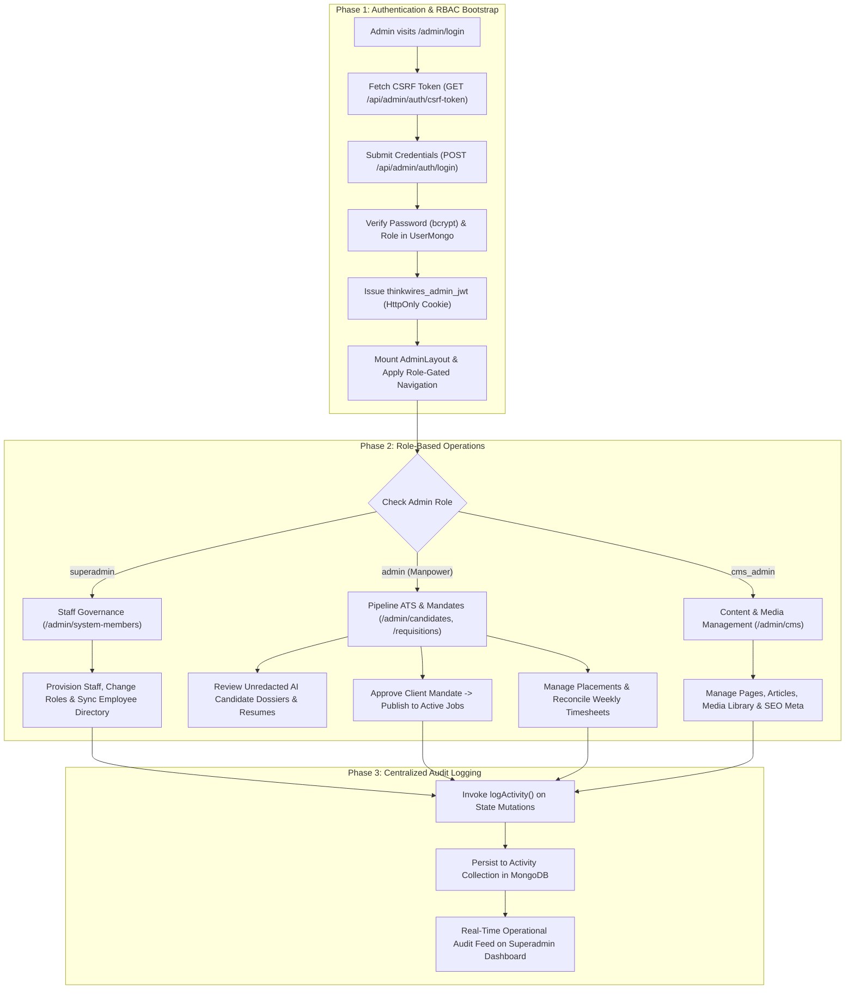

# Admin Workflow & Technical Architecture

## 1. Overview

The **Admin Portal** in ThinkWires is an enterprise administration and recruitment operations suite. It provides role-based access control (RBAC) across three distinct administrative tiers:
- **`superadmin`**: Full, uninhibited authority across all system modules, system members, credential revocation, and global configurations.
- **`admin` (Manpower / ATS Recruiter)**: Workforce management, candidate pipeline tracking, unredacted evaluation dossier reviews, client mandates, job postings, and engineer placements.
- **`cms_admin` (Content Manager)**: Content Management System operations including website landing pages, technical blog articles, media assets, SEO metadata, and announcements.

This document details the complete end-to-end admin workflow architecture, role-based boundary enforcement, and phase-by-phase technical execution across `apps/frontend`, `apps/backend`, and `apps/ai_services`.

---

## 2. End-to-End Workflow Architecture

---

## 3. Role-Based Access Control (RBAC) Hierarchy

The middleware `requireRole` (`apps/backend/src/middlewares/auth.middleware.js`) strictly gates route execution:

| Module / Operation | Route Prefix | Allowed Roles | Guard Middleware |
| :--- | :--- | :---: | :--- |
| **System Member RBAC** | `/api/admin/system-members` | `superadmin` | `requireRole('superadmin')` |
| **Dashboard Analytics** | `/api/admin/stats` | `superadmin`, `admin` | `requireRole('superadmin', 'admin')` |
| **Employees Directory** | `/api/admin/employees` | `superadmin`, `admin` | `requireRole('superadmin', 'admin')` |
| **Candidate ATS & Dossiers** | `/api/admin/candidates` | `superadmin`, `admin` | `requireRole('superadmin', 'admin')` |
| **Clients & Mandates** | `/api/admin/clients`, `/jobs` | `superadmin`, `admin` | `requireRole('superadmin', 'admin')` |
| **Placements & Timesheets** | `/api/admin/placements` | `superadmin`, `admin` | `requireRole('superadmin', 'admin')` |
| **Content Management (CMS)** | `/api/admin/cms/*`, `/seo-settings` | `superadmin`, `cms_admin` | `requireRole('superadmin', 'cms_admin')` |
| **System Activity Feed** | `/api/admin/activities` | All authenticated admins | `requireAuth()` |

---

## 4. Phase-by-Phase Technical Breakdown

### Phase 1: Authentication, CSRF & Session Lifecycle
* **Endpoints**:
  - `GET /api/admin/auth/csrf-token`
  - `POST /api/admin/auth/login`
  - `GET /api/admin/auth/me`
  - `POST /api/admin/auth/logout`
* **Controllers & Utilities**:
  - `apps/backend/src/controllers/admin.controller.js` (lines 3184–3330)
  - `apps/backend/src/middlewares/csrf.middleware.js`
  - `apps/backend/src/utils/auth.util.js`
* **Execution Mechanics**:
  1. Before authentication, the client fetches a cryptographically random CSRF token via `/auth/csrf-token`.
  2. The candidate logs in with official credentials; the server verifies the password with `bcrypt.compare` against `UserMongo`.
  3. A signed administrative JWT (`portal: 'admin'`, `role: user.role`) is generated and attached via cookie (`thinkwires_admin_jwt`) across paths `/api/admin`, `/api`, and `/`.
  4. State-changing requests are guarded by double-submit CSRF checks and OWASP-compliant verified authorization header bypasses.
  5. Upon logout, tokens are revoked via Redis/in-memory set (`revokeToken`), and cookies are invalidated across all path scopes.

---

### Phase 2: Superadmin Governance & System Members
* **Endpoints**:
  - `GET /api/admin/system-members`
  - `POST /api/admin/system-members`
  - `PUT /api/admin/system-members/:id`
  - `DELETE /api/admin/system-members/:id`
* **Controller**: `apps/backend/src/controllers/admin.controller.js` (lines 3370–3720)
* **Models**: `UserMongo`, `Employee`
* **Execution Mechanics**:
  1. Superadmins create and manage administrative staff credentials (`superadmin`, `admin`, `cms_admin`).
  2. Updating an administrator’s role or status automatically syncs corresponding records in the internal `Employee` directory (`portalAccess: true/false`).
  3. Deletion handlers enforce strict self-protection rules: root superadmin (`superadmin@thinkwires.com`) and the currently active session user cannot be deleted.

---

### Phase 3: Manpower & ATS Candidate Pipeline Management
* **Endpoints**:
  - `GET /api/admin/candidates`
  - `GET /api/admin/candidates/:id/dossier`
  - `PATCH /api/admin/candidates/:id/status`
  - `POST /api/admin/candidates/:id/re-evaluate`
  - `DELETE /api/admin/candidates/:id`
* **Controller**: `apps/backend/src/controllers/admin.controller.js` (lines 750–1280)
* **Components**: 
  - `apps/frontend/src/admin/CandidatesView.jsx`
  - `apps/frontend/src/admin/CandidateEvaluationModal.jsx`
* **Execution Mechanics**:
  1. **Pipeline Aggregation**: Aggregates candidate records from `JobApplication` and standalone registered `Candidate` models.
  2. **Unredacted Evaluation Dossier**: Retrieves the full AI evaluation report, breakdown of matched vs. missing skills, candidate notes, and verified resume links.
  3. **Stage Transitions**: Recruiters update candidate progress through standard ATS stages:
     $$\text{Applied} \longrightarrow \text{Screening} \longrightarrow \text{Interview} \longrightarrow \text{Offered} \longrightarrow \text{Hired} \text{ / } \text{Rejected}$$
  4. **On-Demand Re-Evaluation**: Recruiters can trigger `reEvaluateCandidate`, executing `aiService.evaluateCandidate` against updated job descriptions or skills.

---

### Phase 4: Enterprise Requisitions & Client Mandates Approval
* **Endpoints**:
  - `GET /api/admin/jobs`
  - `POST /api/admin/jobs`
  - `PUT /api/admin/jobs/:id`
  - `DELETE /api/admin/jobs/:id`
* **Components**: `apps/frontend/src/admin/RequisitionsView.jsx`
* **Execution Mechanics**:
  1. Inbound corporate talent orders submitted via `/api/find-talent/requisition` are logged as internal requisitions with `status: 'Inbound Request'`.
  2. Recruiters review headcount, seniority, notice period benchmarks, and budget envelopes.
  3. Through the **"Approve Client Mandate"** modal, recruiters approve and publish the requisition into active job openings (`status: 'Active'`), immediately making it eligible for candidate applications.

---

### Phase 5: Client Accounts, Placements & Timesheets
* **Endpoints**:
  - `GET /api/admin/clients`, `POST /api/admin/clients`, `PUT /api/admin/clients/:id`
  - `GET /api/admin/placements`, `POST /api/admin/placements`, `PUT /api/admin/placements/:id`
* **Components**:
  - `apps/frontend/src/admin/PlacementsView.jsx`
* **Execution Mechanics**:
  1. Tracks enterprise clients (IT, Banking, Healthcare) under active contracts (Staff Augmentation, EOR, Permanent).
  2. When a candidate reaches `Hired`, an enterprise `Placement` record is generated linking candidate, client, billing rate, pay rate, and deployment start date.
  3. Weekly timesheets logged by placed engineers are reconciled against client approval desks.

---

### Phase 6: Content Management System (CMS) Administration
* **Endpoints**:
  - `GET/PUT /api/admin/cms/pages`, `GET /api/admin/cms/pages/:slug`
  - `GET/POST/PUT/DELETE /api/admin/cms/articles`
  - `GET/POST/DELETE /api/admin/cms/media`
  - `GET/POST/DELETE /api/admin/announcements`
  - `GET/PUT /api/admin/seo-settings`
* **Models**: `Page`, `Article`, `Media`, `Announcement`
* **Execution Mechanics**:
  1. Restrictive access delegated strictly to `cms_admin` and `superadmin`.
  2. Modifies landing page sections, published articles, research publications, and corporate marquee partner logos.
  3. Controls global site meta descriptions, Open Graph titles, and sitewide alert banners.

---

### Phase 7: Centralized Audit Logging
* **Endpoint**: `GET /api/admin/activities`
* **Model**: `Activity` (`apps/backend/src/models/activity.mongo.model.js`)
* **Execution Mechanics**:
  1. Every administrative mutation (creating system members, updating candidates, approving requisitions, publishing CMS pages) invokes `logActivity()`.
  2. Writes structured entries including `action`, `entityType`, `entityId`, `description`, `badgeColor`, and the acting `user` (`name`, `role`, `id`).
  3. The real-time activity stream on the Superadmin dashboard surfaces chronological operational logs across all platform desks.

