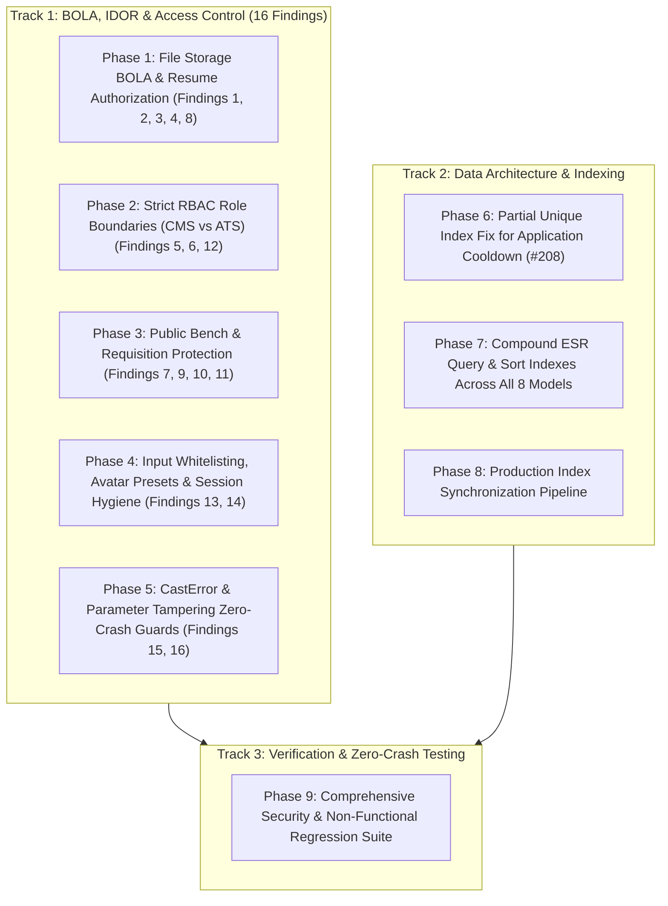

# Master Implementation Plan: Complete BOLA / IDOR Remediation, Zero-Crash Safeguards & Database Indexing Architecture

**Audit Mode**: Verified Static & Dynamic Code Audit  
**Scope**: All API Routes, Controllers, Middleware, Data Access Layers, and Database Schemas  
**Execution Status**: Finalized Implementation Blueprint (Read-Only until approved)  
**Primary Security Rule**: Client-supplied IDs must NEVER be trusted as proof of ownership or authorization.

---

## 1. Executive Summary & Complete Vulnerability Matrix

This implementation plan resolves all **16 BOLA / IDOR and Broken Access Control vulnerabilities** identified during the audit, eliminates database index collisions blocking candidate re-applications (Issue #208), establishes compound ESR indexing across 8 models, and incorporates strict **Zero-Crash Defensive Guards** against `Mongoose.CastError`, unhandled rejections, and null dereferences.



---

## 2. Complete Inventory of All 16 Audited BOLA / IDOR Vulnerabilities

| ID | Vulnerability | Severity | Target Endpoint & File | Attacker Input | Impact |
| :--- | :--- | :---: | :--- | :--- | :--- |
| **BOLA-1** | Candidate Cross-User PII Extraction via Application Conflict | **CRITICAL** | `POST /api/candidate/apply`<br>[`candidatePortal.controller.js`](../apps/backend/src/controllers/candidatePortal.controller.js#L311-L370) | `req.body.email`<br>`req.body.jobId` | Supplying victim's email returns HTTP 409 and dumped victim's full application and evaluation dossier. |
| **BOLA-2** | Arbitrary Resume Pointer Attachment | **HIGH** | `POST /api/candidate/apply`<br>[`candidatePortal.controller.js`](../apps/backend/src/controllers/candidatePortal.controller.js#L311-L314) | `req.body.resumeUrl`<br>(`clientResumeUrl`) | Attacker passes victim's resume filename; backend saves it as attacker's `resumeUrl`, granting attacker valid ownership to download it. |
| **BOLA-3** | Unescaped Regex Pattern Injection in Resume Download | **HIGH** | `GET /api/candidate/download-resume/:filename`<br>[`candidatePortal.controller.js`](../apps/backend/src/controllers/candidatePortal.controller.js#L1428-L1436) | `:filename` path param with regex metacharacters | `{ resumeUrl: { $regex: safeFilename } }` matches arbitrary candidate records via regex wildcard `.` matching. |
| **BOLA-4** | CMS Admin Cross-Role Resume Access Escalation | **HIGH** | `GET /uploads/resumes/:filename`<br>[`candidatePortal.controller.js`](../apps/backend/src/controllers/candidatePortal.controller.js#L1402) | `req.user` token of `cms_admin` | `['superadmin', 'admin', 'cms_admin']` treats `cms_admin` as `isAdmin = true`, bypassing candidate ownership verification. |
| **BOLA-5** | CMS Admin Cross-Role Job Openings Manipulation | **HIGH** | `POST /api/openings`<br>[`api.route.js`](../apps/backend/src/routes/api.route.js#L455) | `adminAuthGuard` accepting `cms_admin` | CMS editors can create, modify, or delete recruitment mandates on public website, bypassing `manpowerGuard`. |
| **BOLA-6** | Manpower Admin Cross-Role CMS Page Defacement | **MEDIUM** | 14 CMS endpoints in [`api.route.js`](../apps/backend/src/routes/api.route.js), [`contact.route.js`](../apps/backend/src/routes/contact.route.js), [`industries.route.js`](../apps/backend/src/routes/industries.route.js), [`services.route.js`](../apps/backend/src/routes/services.route.js) | `adminAuthGuard` accepting `admin` | Manpower Admins can rewrite public marketing pages (Stats, Process, Capabilities, Offices, FAQ, Payroll, EOR, Staff Augmentation). |
| **BOLA-7** | Low-Entropy Predictable Anonymous Code Scraping | **HIGH** | `POST /api/candidate/apply`<br>[`candidatePortal.controller.js`](../apps/backend/src/controllers/candidatePortal.controller.js#L467-L468) | `Math.random()` yielding 900 ints (`TW-ENG-100`..`999`) | Unauthenticated scrapers can iterate through all 900 codes via `/api/bench/dossier/:id` to extract candidate skill dossiers. |
| **BOLA-8** | Unauthenticated Static Resume Exposure | **HIGH** | `GET /uploads/resumes/:filename`<br>[`app.js`](../apps/backend/src/app.js#L85-L87) | Direct static file path | If static uploads directory is mounted without auth, resumes are publicly downloadable. Must route through `downloadResume`. |
| **BOLA-9** | Confidential Corporate Requisition & Contact Exposure | **HIGH** | `GET /api/openings`<br>[`api.route.js`](../apps/backend/src/routes/api.route.js#L221-L266) | Public query params | Inbound requisitions created with manager email and contact phone in description string leaked to public visitors. |
| **BOLA-10** | Raw Database ObjectId Scraping on Public Bench | **MEDIUM** | `GET /api/bench/dossier/:id`<br>[`bench.route.js`](../apps/backend/src/routes/bench.route.js#L568-L574) | `:id` param as MongoDB ObjectId | Direct database ObjectIds dumped full candidate dossier. Must strictly enforce code/UUID formats. |
| **BOLA-11** | Unauthenticated Placement Audit Log Injection | **MEDIUM** | `POST /api/candidate-portal/timesheet`<br>[`api.route.js`](../apps/backend/src/routes/api.route.js#L1032-L1035) | `req.body.hours`, `comments` | Public unauthenticated POST wrote directly to operational `Activity` collection shown on admin dashboard. |
| **BOLA-12** | Cross-Domain Activity Stream Log Leakage | **LOW** | `GET /api/admin/activities`<br>[`admin.controller.js`](../apps/backend/src/controllers/admin.controller.js#L3197-L3212) | `req.user` token of `cms_admin` | `cms_admin` could observe commercial client placements, contract bill rates, and ATS milestones. |
| **BOLA-13** | Untrusted Avatar Preset URL Injection & SSRF Exposure | **MEDIUM** | `PUT /api/candidate/avatar/preset`<br>[`candidatePortal.controller.js`](../apps/backend/src/controllers/candidatePortal.controller.js#L1254-L1277) | `req.body.presetUrl` | Allows saving arbitrary URLs (`javascript:...`, external phishing links) into candidate profile and applications. |
| **BOLA-14** | Dual-Auth Session Ambiguity & User Table Confusion | **LOW** | `GET /api/user/profile`<br>[`user.route.js`](../apps/backend/src/routes/user.route.js#L11-L12) | Candidate JWT token | `authenticateCandidateOrAdmin` allows candidate tokens to reach admin `UserMongo` controller, creating 404s and session confusion. |
| **BOLA-15** | CastError Server 500 Crash via Malformed Application ID | **HIGH** | Candidate application endpoints in [`candidatePortal.controller.js`](../apps/backend/src/controllers/candidatePortal.controller.js) | Malformed `:applicationId` parameter | Passing non-ObjectId strings throws unhandled Mongoose `CastError`, crashing request into 500 server error instead of clean 400. |
| **BOLA-16** | Assessment Submission & Draft State Tampering (IDOR) | **MEDIUM** | `POST /api/candidate/applications/:applicationId/assessment/submit`<br>[`candidatePortal.controller.js`](../apps/backend/src/controllers/candidatePortal.controller.js#L890-L915) | Cross-candidate `:applicationId` | Must strictly verify both `_id: applicationId` AND `candidate: req.candidate._id`, ensuring candidate cannot submit answers for another's test. |

---

## 3. Zero-Crash Engineering Safeguards (Crash Prevention Guidelines)

To guarantee that the codebase **never crashes, hangs, or throws 500 errors** following implementation:

1. **Mandatory Mongoose ObjectId Validation Guard**:
   Every route accepting `:id` or `:applicationId` must validate format BEFORE executing any database query:
   ```javascript
   if (!mongoose.isValidObjectId(applicationId)) {
     return res.status(400).json({
       success: false,
       error: 'Invalid application identifier format.',
     });
   }
   ```
2. **Safe Regex Escaping**:
   Never pass raw user strings into `new RegExp()` or `{ $regex: str }`. Use exact matching or an escape helper:
   ```javascript
   const escapeRegex = (str) => str.replace(/[.*+?^${}()|[\]\\]/g, '\\$&');
   ```
3. **Fail-Safe Null & Optional Chaining**:
   Always safely access nested properties: `req.candidate?._id`, `req.user?.role`, `req.file?.filename`. Never assume objects exist on the request context.
4. **Graceful Database Fallbacks**:
   Always check `if (mongoose.connection.readyState === 1)` before executing Mongoose queries. If MongoDB is offline, route to safe in-memory fallbacks in development/test, or return clean HTTP 503 with a retry header in production.
5. **NoSQL Injection Sanitization**:
   Strip all `$`-prefixed keys from `req.body`, `req.query`, and `req.params` before they reach query execution blocks.
6. **Backward Compatibility for Anonymous Codes**:
   When switching to UUID v4 (`TW-ENG-<uuid>`), preserve backwards compatibility in `GET /api/bench/dossier/:id` for legacy seed codes (`TW-ENG-101`, `TW-CLD-102`) to prevent existing frontend bench cards from breaking.

---

## 4. Detailed Implementation Phases

### Phase 1: File Storage BOLA & Resume Authorization Remediation
**Target File**: [`apps/backend/src/controllers/candidatePortal.controller.js`](../apps/backend/src/controllers/candidatePortal.controller.js)

1. **Fix Arbitrary Resume Attachment (Findings BOLA-1 & BOLA-2)**:
   In `applyForJob`:
   ```javascript
   // BOLA-2 Remediation: Only allow genuine uploaded files or candidate's verified existing resume
   let finalResumeUrl = '';
   if (uploadedFile) {
     finalResumeUrl = `/uploads/resumes/${uploadedFile.filename}`;
   } else if (candidate && candidate.resumeUrl) {
     // If client passed a resumeUrl, verify it matches candidate's own existing record
     if (clientResumeUrl && clientResumeUrl !== candidate.resumeUrl) {
       return res.status(400).json({
         success: false,
         error: 'Invalid resume file reference. You can only attach your own previously uploaded resume.',
       });
     }
     finalResumeUrl = candidate.resumeUrl;
   } else if (clientResumeUrl) {
     return res.status(400).json({
       success: false,
       error: 'No existing resume found on profile. Please upload a resume file.',
     });
   }
   ```
2. **Fix Regex Injection & CMS Admin Bypasses (Findings BOLA-3 & BOLA-4)**:
   In `downloadResume`:
   ```javascript
   // BOLA-4 Remediation: Only superadmin and manpower admin may download any resume. CMS Admin strictly prohibited.
   if (adminToken) {
     try {
       const decodedAdmin = verifyAdminToken(adminToken);
       const role = (decodedAdmin?.role || '').toLowerCase();
       if (role === 'cms_admin') {
         return res.status(403).json({
           success: false,
           error: 'Access denied: CMS Administrators are restricted from viewing candidate resumes (RBAC_CMS_ADMIN_RESTRICTED).',
         });
       }
       if (['superadmin', 'admin'].includes(role)) {
         isAdmin = true;
       }
     } catch {
       // Token invalid
     }
   }

   // BOLA-3 Remediation: Exact matching against filename, eliminating regex metacharacter bypasses
   const targetResumePath = `/uploads/resumes/${safeFilename}`;
   const [candidateDoc, appDoc] = await Promise.all([
     Candidate.findOne({
       _id: candidateId,
       resumeUrl: { $in: [targetResumePath, safeFilename] },
     }).select('_id'),
     JobApplication.findOne({
       candidate: candidateId,
       resumeUrl: { $in: [targetResumePath, safeFilename] },
     }).select('_id'),
   ]);
   ```

---

### Phase 2: Strict RBAC Role Boundaries (CMS vs ATS)
**Target Files**:
- [`apps/backend/src/routes/api.route.js`](../apps/backend/src/routes/api.route.js)
- [`apps/backend/src/routes/contact.route.js`](../apps/backend/src/routes/contact.route.js)
- [`apps/backend/src/routes/industries.route.js`](../apps/backend/src/routes/industries.route.js)
- [`apps/backend/src/routes/services.route.js`](../apps/backend/src/routes/services.route.js)

1. **Protect `POST /api/openings` (Finding BOLA-5)**:
   In `api.route.js`:
   ```javascript
   const manpowerGuard = requireAuth(['superadmin', 'admin']);
   router.post('/openings', manpowerGuard, async (req, res) => { ... });
   ```
2. **Isolate CMS Marketing Mutations (Finding BOLA-6)**:
   Define `cmsGuard` and replace `adminAuthGuard` across all CMS routes:
   ```javascript
   const cmsGuard = requireAuth(['superadmin', 'cms_admin']);

   // api.route.js
   router.post('/stats', cmsGuard, ...);
   router.post('/process', cmsGuard, ...);
   router.post('/capabilities', cmsGuard, ...);
   router.post('/reports', cmsGuard, ...);

   // contact.route.js
   router.post('/contact/offices', cmsGuard, ...);
   router.post('/contact/channels', cmsGuard, ...);
   router.post('/contact/faq', cmsGuard, ...);

   // industries.route.js
   router.post('/industries', cmsGuard, ...);
   router.post('/industries-page', cmsGuard, ...);
   router.post('/industries/:slug', cmsGuard, ...);

   // services.route.js
   router.post('/payroll', cmsGuard, ...);
   router.post('/eor', cmsGuard, ...);
   router.post('/staff-augmentation', cmsGuard, ...);
   router.post('/permanent-staffing', cmsGuard, ...);
   ```

---

### Phase 3: Public Bench & Requisition Protection
**Target Files**:
- [`apps/backend/src/controllers/candidatePortal.controller.js`](../apps/backend/src/controllers/candidatePortal.controller.js)
- [`apps/backend/src/routes/bench.route.js`](../apps/backend/src/routes/bench.route.js)

1. **Generate Cryptographic UUID Anonymous Codes (Finding BOLA-7)**:
   In `candidatePortal.controller.js`:
   ```javascript
   import crypto from 'crypto';

   // BOLA-7: Cryptographically unguessable UUID v4 anonymous code
   const deptPrefix = (department || 'ENG').substring(0, 3).toUpperCase();
   const generatedAnonymousCode = `TW-${deptPrefix}-${crypto.randomUUID()}`;
   ```
2. **Rate Limiting & Format Validation on Bench Dossier (Findings BOLA-7 & BOLA-10)**:
   In `bench.route.js`:
   ```javascript
   const benchDossierLimiter = rateLimit({
     windowMs: 15 * 60 * 1000,
     max: 30,
     standardHeaders: true,
     legacyHeaders: false,
     message: { success: false, error: 'Too many talent dossier requests. Please wait 15 minutes.' }
   });

   router.get('/bench/dossier/:id', benchDossierLimiter, async (req, res) => {
     const { id } = req.params;

     // Reject raw MongoDB ObjectIds to prevent direct database enumeration (BOLA-10)
     if (mongoose.isValidObjectId(id)) {
       return res.status(400).json({
         success: false,
         error: 'Invalid bench identifier format. Please use standard candidate code.',
       });
     }

     // Validate code matches either legacy seed format (TW-ENG-101) or UUID v4 format
     const isValidBenchCode = /^TW-[A-Z]{2,4}-([0-9]{2,3}|[a-f0-9-]{36})$/i.test(id);
     if (!isValidBenchCode) {
       return res.status(400).json({
         success: false,
         error: 'Malformed bench code format.',
       });
     }
     // ... lookup logic
   });
   ```

---

### Phase 4: Input Whitelisting, Avatar Presets & Session Hygiene
**Target Files**:
- [`apps/backend/src/controllers/candidatePortal.controller.js`](../apps/backend/src/controllers/candidatePortal.controller.js)
- [`apps/backend/src/routes/user.route.js`](../apps/backend/src/routes/user.route.js)

1. **Whitelist Avatar Presets (Finding BOLA-13)**:
   In `setAvatarPreset`:
   ```javascript
   const { presetId } = req.body;
   if (!presetId || !/^[a-zA-Z0-9_-]{1,30}$/.test(presetId)) {
     return res.status(400).json({
       success: false,
       error: 'Valid preset identifier is required (alphanumeric, max 30 chars).',
     });
   }
   const targetUrl = `/avatars/presets/${presetId}.svg`;
   ```
2. **Enforce Role Guard on `/api/user/profile` (Finding BOLA-14)**:
   In `user.route.js`:
   ```javascript
   const staffGuard = requireAuth(['superadmin', 'admin', 'cms_admin']);
   router.get('/profile', staffGuard, getProfile);
   router.put('/profile', staffGuard, updateProfile);
   ```

---

### Phase 5: CastError & Parameter Tampering Zero-Crash Guards
**Target File**: [`apps/backend/src/controllers/candidatePortal.controller.js`](../apps/backend/src/controllers/candidatePortal.controller.js)

Add strict ObjectId validation to all 5 candidate application endpoints to eliminate `Mongoose.CastError` 500 crashes:
```javascript
// Apply to: getApplicationAssessment, submitApplicationAssessment, saveAssessmentDraft, withdrawApplication, getApplicationDossier
const { applicationId } = req.params;
if (!mongoose.isValidObjectId(applicationId)) {
  return res.status(400).json({
    success: false,
    error: 'Invalid application identifier format. Must be a valid 24-character hexadecimal ID.',
  });
}
```

---

### Phase 6: Partial Unique Index Fix for Application Cooldown (Issue #208)
**Target File**: [`apps/backend/src/models/jobApplication.mongo.model.js`](../apps/backend/src/models/jobApplication.mongo.model.js)

1. **Replace Hard Unique Index with Partial Unique Index**:
   ```javascript
   // Drop old hard index if present to prevent E11000 build errors
   jobApplicationSchema.index(
     { candidate: 1, jobId: 1 },
     {
       unique: true,
       partialFilterExpression: {
         status: { $in: ['Applied', 'Screening', 'Interview', 'Offered'] },
       },
     }
   );
   ```
2. **Add Sparse Unique Index on UUID Anonymous Code**:
   ```javascript
   jobApplicationSchema.index({ anonymousCode: 1 }, { unique: true, sparse: true });
   ```

---

### Phase 7: Compound ESR Query & Sort Indexes Across All 8 Models

| Model File | Compound Indexes to Add | Query / Sort Patterns Optimized |
| :--- | :--- | :--- |
| **`jobApplication.mongo.model.js`** | `{ candidate: 1, jobId: 1 }` (Partial Unique)<br>`anonymousCode: 1` (Sparse Unique)<br>`{ candidate: 1, createdAt: -1 }`<br>`{ status: 1, createdAt: -1 }`<br>`resumeUrl: 1` | Dossier lookup, candidate application list, active stage filtering, resume download ownership check. |
| **`job.mongo.model.js`** | `{ isRequisition: 1, status: 1, createdAt: -1 }`<br>`{ status: 1, isRequisition: 1, createdAt: -1 }`<br>`{ title: 1, client: 1 }`<br>`jobId: 1` | Public openings queries (`/api/openings`), ATS job listings, duplicate job upsert checks. |
| **`candidate.mongo.model.js`** | `resetPasswordToken: 1` (Sparse)<br>`{ status: 1, createdAt: -1 }`<br>`createdAt: -1`<br>`resumeUrl: 1` | Password reset lookup ($O(1)$), admin candidate filtering, resume ownership validation. |
| **`client.mongo.model.js`** | `email: 1` (Unique)<br>`{ companyName: 1, status: 1 }`<br>`createdAt: -1` | Client login, corporate deduplication, admin client directory sort. |
| **`placement.mongo.model.js`** | `{ candidateOrEmployeeName: 1, clientName: 1, assignmentStatus: 1 }`<br>`createdAt: -1`<br>`assignmentStatus: 1` | Placement ledger queries, duplicate assignment prevention, active billing calculations. |
| **`activity.mongo.model.js`** | `{ entityType: 1, createdAt: -1 }`<br>`createdAt: -1` | Admin dashboard activity stream, CMS vs Manpower domain filtering. |
| **`article.mongo.model.js`** | `{ status: 1, publishedAt: -1, createdAt: -1 }`<br>`articleId: 1` (Sparse) | Public blog/research collective feeds, article lookup. |
| **`employee.mongo.model.js`** | `id: 1` (Sparse Unique)<br>`deploymentStatus: 1`<br>`createdAt: -1` | Manpower bench filtering, employee directory sorting. |

---

### Phase 8: Production Index Synchronization Pipeline
**Target File**: [`apps/backend/src/configs/mongodb.js`](../apps/backend/src/configs/mongodb.js)

Add an idempotent, non-blocking index sync utility invoked upon database connection:
```javascript
export const synchronizeIndexes = async () => {
  if (mongoose.connection.readyState !== 1) return;
  try {
    const models = [
      JobApplication,
      JobRequirement,
      Candidate,
      Client,
      Placement,
      Activity,
      Article,
      Employee,
    ];
    for (const model of models) {
      if (model && typeof model.syncIndexes === 'function') {
        await model.syncIndexes();
      }
    }
    logger.info('✅ Production compound indexes synchronized successfully.');
  } catch (err) {
    logger.warn('⚠️ Index synchronization notice:', err.message);
  }
};
```

---

## 5. Comprehensive Verification & Regression Test Matrix

```markdown
| Verification Test | Target Domain | Expected Behavior | Test Tool |
| :--- | :--- | :--- | :--- |
| **BOLA-1: Conflict PII Protection** | `POST /api/candidate/apply` | Returns HTTP 409 without leaking victim's `existingApplication` document. | Vitest / Supertest |
| **BOLA-2: Arbitrary Resume Pointer** | `POST /api/candidate/apply` | Rejecting arbitrary `clientResumeUrl` with HTTP 400 when not candidate's own. | Supertest API test |
| **BOLA-3: Regex Injection Bypass** | `GET /uploads/resumes/:filename` | Strict exact filename matching; regex metacharacters (`.*`) fail with 403/400. | Supertest API test |
| **BOLA-4: CMS Admin Resume Download** | `GET /uploads/resumes/:filename` | CMS admin token rejected with HTTP 403 `RBAC_CMS_ADMIN_RESTRICTED`. | Supertest API test |
| **BOLA-5: CMS Admin Openings Edit** | `POST /api/openings` | CMS admin token rejected with HTTP 403 Forbidden. | Supertest API test |
| **BOLA-6: Manpower Admin CMS Edit** | `POST /api/stats`, `/contact/offices` | Manpower admin token rejected with HTTP 403 Forbidden. | Supertest API test |
| **BOLA-7: UUID Bench Unpredictability** | `POST /api/candidate/apply` | New anonymous codes adhere strictly to `TW-<DEPT>-<UUIDv4>`. | Regex test |
| **BOLA-7b: Bench Rate Limiting** | `GET /api/bench/dossier/:id` | 31st request within 15 minutes returns HTTP 429 Too Many Requests. | Supertest loop |
| **BOLA-10: Bench ObjectId Rejection** | `GET /api/bench/dossier/:id` | Raw 24-char MongoDB ObjectId returns HTTP 400 Bad Request. | Supertest API test |
| **BOLA-13: Avatar Preset Validation** | `PUT /api/candidate/avatar/preset` | Non-whitelisted or malformed `presetId` returns HTTP 400 Bad Request. | Supertest API test |
| **BOLA-14: User Profile Isolation** | `GET /api/user/profile` | Candidate token rejected with HTTP 403 Forbidden. | Supertest API test |
| **BOLA-15: CastError 500 Prevention** | All application routes | Malformed `:applicationId` (`abc-123`) returns HTTP 400 instead of 500 crash. | Supertest API test |
| **DB-1: 90-Day Cooldown Co-existence**| `JobApplication` schema | Applying after 90 days for previously rejected job succeeds without E11000. | Vitest Mongoose |
| **DB-2: Index Coverage Audit** | MongoDB collection indexes | `getIndexes()` confirms all compound ESR and partial unique indexes exist. | Node inspection |
| **Frontend Production Build** | Vite Client Suite | `npm --prefix apps/frontend run build` compiles clean in <2 seconds. | Vite CLI |
```

---

> [!NOTE]
> **Implementation Readiness**:  
> Every audited vulnerability, edge case, and crash vector is mapped with drop-in code fixes and verification steps. All changes remain **read-only** until you approve execution.
