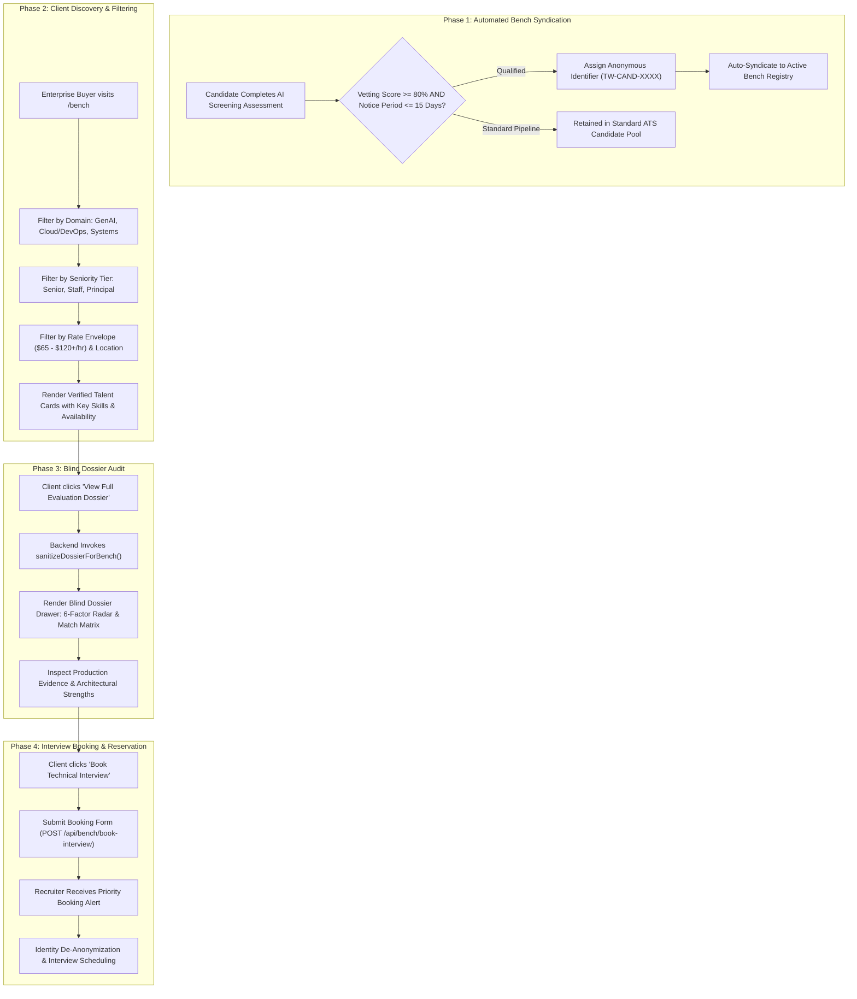

# Talent Cloud Bench & Sourcing Workflow

## 1. Overview

The **Talent Cloud Bench Workflow** is ThinkWires' marketplace for immediately deployable, pre-vetted senior software engineers. It facilitates **blind candidate sourcing**, enabling enterprise buyers to inspect verified architectural competencies, code audit results, and hourly rates while preserving candidate privacy until technical interviews are formally scheduled.

---

## 2. End-to-End Workflow Architecture

---

## 3. Phase-by-Phase Technical Breakdown

### Phase 1: Bench Syndication Criteria & Ingestion
* **Endpoint**: `GET /api/bench/talents`
* **Route**: `apps/backend/src/routes/api.route.js` (lines 1195–1365)
* **Models**: `Candidate`, `JobApplication`
* **Syndication Rule Engine**:
  A candidate is eligible for the live Bench catalog when:
  $$\text{Vetting Score} \ge 80\% \quad \text{AND} \quad \text{Notice Period} \in \{\text{'Immediate'}, \text{'15 Days'}\}$$
* **Anonymization Pipeline**:
  - Legal names are converted to two-letter monograms or initials (`TW`).
  - IDs are assigned public codes: `TW-CAND-${c._id.slice(-4).toUpperCase()}`.
  - Seniority tiers are calculated dynamically based on verified years:
    - $\ge 8\text{ years}$: Principal / Staff Engineer
    - $\ge 5\text{ years}$: Senior Engineer
    - $3 - 5\text{ years}$: Mid-Level Specialist

---

### Phase 2: Client Marketplace Exploration & Filtering
* **Frontend View**: `apps/frontend/src/pages/BenchPage.jsx`
* **Components**: 
  - `apps/frontend/src/components/BenchComponents/BenchFilterBar.jsx`
  - `apps/frontend/src/components/BenchComponents/BenchDossierFeatures.jsx`
* **Store Slice**: `apps/frontend/src/store/slices/benchSlice.js`
* **Supported Dimensions**:
  - **Specialty Domains**: GenAI & LLMs, Cloud & DevOps, Systems & Distributed, Frontend/Fullstack.
  - **Urgency Filters**: Immediate (24–48h), Within 7 Days, Within 14 Days.
  - **Budget Envelopes**: \$50–\$75/hr, \$75–\$100/hr, \$100+/hr.
  - **Search Query**: Real-time substring matching across technical skills and verified project proofs.

---

### Phase 3: Blind Evaluation Dossier Drawer
* **Endpoint**: `GET /api/bench/dossier/:id`
* **Component**: `apps/frontend/src/components/BenchComponents/BenchDossierDrawer.jsx`
* **Sanitization Engine**: `aiService.sanitizeDossierForBench` (`apps/backend/src/services/ai.service.js`)
* **Execution Mechanics**:
  1. Retrieves the underlying AI evaluation dossier from the database.
  2. Runs regex sanitization replacing candidate names with `Candidate ${anonymousCode}`.
  3. Strips current and past employer names to eliminate corporate bias and prevent unauthorized backchannel outreach.
  4. Surfaces the **Requirement Alignment Matrix** showing verified evidence against industry standard frameworks.

---

### Phase 4: Interview Booking & Reservation Desk
* **Endpoint**: `POST /api/bench/book-interview`
* **Rate Limiter**: `publicSubmissionRateLimiter` (30 requests / 15 mins)
* **Execution Mechanics**:
  1. Enterprise hiring managers submit desired interview dates, target client company, and technical requirements.
  2. The backend creates an audit log entry (`Activity.create`) tagged with `#2563EB` badge color.
  3. Sends dispatch notifications to the ThinkWires recruiter desk.
  4. Recruiter de-anonymizes candidate credentials with mutual consent and confirms calendar invites for technical panel evaluation.

