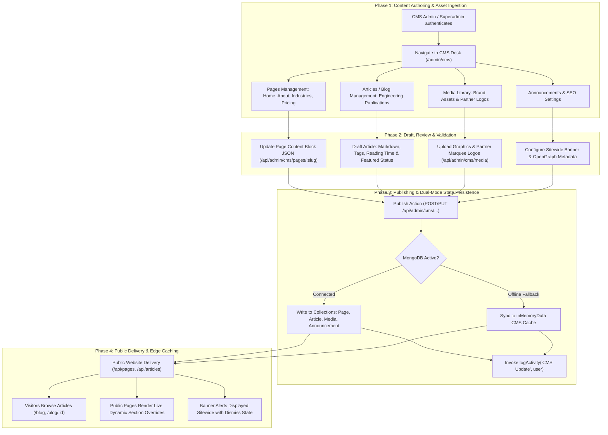

# Content Management System (CMS) & Publishing Workflow

## 1. Overview

The **CMS Workflow** in ThinkWires governs website content creation, thought leadership technical articles, digital media asset management, sitewide emergency announcement banners, and global SEO metadata orchestration.

Access to CMS operations is restricted by RBAC strictly to **`cms_admin`** and **`superadmin`** accounts.

---

## 2. End-to-End Workflow Architecture

---

## 3. Phase-by-Phase Technical Breakdown

### Phase 1: Access Control & Module Authorization
* **Route Group**: `/api/admin/cms/*`, `/api/admin/announcements`, `/api/admin/seo-settings`
* **RBAC Guard**: `requireRole('superadmin', 'cms_admin')`
* **Route Declaration**: `apps/backend/src/routes/admin.route.js` (lines 136–168)
* **Execution Mechanics**:
  1. Requests must carry valid admin JWT credentials (`thinkwires_admin_jwt`).
  2. Enforces that recruiters with role `admin` cannot mutate CMS assets, while `cms_admin` users cannot inspect candidate PII or placement records.

---

### Phase 2: Page Content & Section Orchestration
* **Endpoints**: 
  - `GET /api/admin/cms/pages`
  - `GET /api/admin/cms/pages/:slug`
  - `PUT /api/admin/cms/pages/:slug`
* **Public Route**: `GET /api/pages/:slug` (`apps/backend/src/routes/api.route.js`)
* **Model**: `Page` (`apps/backend/src/models/page.mongo.model.js`)
* **Execution Mechanics**:
  1. Each public page (e.g. `home`, `about`, `industries`, `process`, `eor`) has a backing JSON document in the `Page` collection.
  2. The CMS admin can edit live statistics (e.g. *Enterprise Engineers Deployed*, *Global Client Count*, *Client Retention Rate*) and partner logos without code redeployment.
  3. The public API fetches the custom database override; if the database is unpopulated, it falls back to bundled static seed fixtures (`apps/backend/src/data/pages/*.json`).

---

### Phase 3: Technical Articles & Thought Leadership
* **Admin Endpoints**:
  - `GET /api/admin/cms/articles`
  - `POST /api/admin/cms/articles`
  - `PUT /api/admin/cms/articles/:id`
  - `PATCH /api/admin/cms/articles/:id/publish`
  - `DELETE /api/admin/cms/articles/:id`
* **Public Endpoints**:
  - `GET /api/articles`
  - `GET /api/articles/:id`
  - `GET /api/articles/featured`
  - `POST /api/articles/newsletter`
* **Model**: `Article` (`apps/backend/src/models/article.mongo.model.js`)
* **Execution Mechanics**:
  1. Supports rich technical publications covering AI engineering, cloud migrations, and distributed systems.
  2. Fields include: `title`, `slug`, `excerpt`, `content` (Markdown), `author` (name, role, avatar), `readTime`, `tags`, `isFeatured`, and `publishedAt`.
  3. One-click publishing toggle transitions articles between `draft` and `published` states.

---

### Phase 4: Sitewide Announcements & SEO Governance
* **Endpoints**:
  - `GET /api/admin/announcements`, `POST /api/admin/announcements`, `PATCH /api/admin/announcements/:id/publish`
  - `GET /api/admin/seo-settings`, `PUT /api/admin/seo-settings`
* **Execution Mechanics**:
  1. **Announcements**: Broadcasts platform updates, urgent hiring calls, or scheduled maintenance banners to all website visitors with dismissable client state.
  2. **SEO Metadata Engine**: Configures global and per-page meta descriptions, canonical URLs, primary keywords, and OpenGraph preview images.

