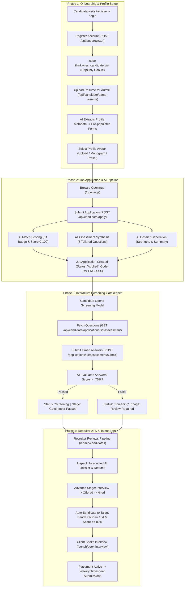

# Candidate Workflow & Technical Architecture

## 1. Overview

The **Candidate Workflow** in ThinkWires manages the lifecycle of talent from initial discovery, authentication, and resume auto-fill parsing, to multi-tier AI evaluation, screening assessment gatekeeping, ATS recruiter review, and Talent Cloud Bench syndication.

This document details the complete end-to-end workflow architecture, lifecycle state transitions, and phase-by-phase technical mechanics across `apps/frontend`, `apps/backend`, and `apps/ai_services`.

---

## 2. End-to-End Workflow Architecture

---

## 3. Phase-by-Phase Technical Breakdown

### Phase 1: Authentication & Identity Management
* **Endpoints**: 
  - `POST /api/auth/register`
  - `POST /api/auth/login`
  - `GET /api/auth/me`
  - `POST /api/auth/logout`
* **Controllers & Services**:
  - `apps/backend/src/controllers/auth.controller.js`
  - `apps/backend/src/utils/auth.util.js`
* **Models**: `Candidate` (`apps/backend/src/models/candidate.mongo.model.js`)
* **Execution Mechanics**:
  1. Candidate registers with name, official email, password, and mobile number.
  2. The server hashes the password with bcrypt (12 salt rounds).
  3. A scoped JSON Web Token (`role: 'candidate'`, `portal: 'candidate'`) is generated and attached via an `HttpOnly`, `SameSite`, `Secure` cookie (`thinkwires_candidate_jwt`).
  4. Redux store (`apps/frontend/src/store/slices/authSlice.js`) hydrates the session state on frontend initialization.

---

### Phase 2: Resume Ingestion & Profile Auto-Fill
* **Endpoints**: 
  - `POST /api/candidate/parse-resume`
  - `PUT /api/candidate/profile`
  - `POST /api/candidate/avatar/upload`
  - `PUT /api/candidate/avatar/preset`
* **Controllers & Services**:
  - `apps/backend/src/controllers/candidatePortal.controller.js`
  - `apps/backend/src/services/ai.service.js`
* **Execution Mechanics**:
  1. Candidates upload PDF, DOC, or DOCX resumes through `multer` (`resumeUpload`).
  2. The raw file buffer is forwarded to `aiService.parseResume` in `apps/ai_services`.
  3. The AI engine extracts structured metadata:
     - First Name & Last Name
     - Email & Phone Number
     - Location (City, State)
     - Total Years of Experience & Current Role
     - Primary Technical Skills & Key Strengths
     - LinkedIn, GitHub, and Portfolio URLs
  4. The frontend auto-populates registration and profile forms, minimizing candidate onboarding friction.
  5. Candidates can select avatar styling: custom photo upload, monogram, or curated SVG presets.

---

### Phase 3: Application Submission & AI Pipeline Execution
* **Endpoint**: `POST /api/candidate/apply`
* **Controller**: `apps/backend/src/controllers/candidatePortal.controller.js` (lines 196–470)
* **Models**: `JobApplication` (`apps/backend/src/models/jobApplication.mongo.model.js`)
* **Execution Mechanics**:
  1. Validates that the request comes from an authenticated candidate (`requireCandidateAuth`).
  2. Verifies single active submission per candidate per opening to prevent duplicate processing.
  3. **Simultaneous AI Triad Execution**:
     - **Match Scoring**: `aiService.calculateMatchScore` compares candidate skills, experience, and notes against the job requirements, producing `skillsMatch`, `experienceMatch`, a composite `fitScore` (0–100), and a `fitBadge` (`Top Match`, `Moderate Match`, `Below Threshold`).
     - **Dynamic Assessment Synthesis**: `aiService.generateAssessment` creates 5 role-specific multiple-choice and scenario questions tailored to the opening.
     - **Evaluation Dossier**: `aiService.evaluateCandidate` builds an in-depth dossier including matched skills, growth areas, engineering strengths, and hiring recommendations.
  4. Generates an anonymous bench code (e.g., `TW-ENG-742`).
  5. Creates a `JobApplication` record with `status: 'Applied'` and `stage: 'Application Received'`.

---

### Phase 4: Interactive Screening Assessment Gatekeeper
* **Endpoints**: 
  - `GET /api/candidate/applications/:id/assessment`
  - `POST /api/candidate/applications/:id/assessment/submit`
* **Components**: `apps/frontend/src/components/common/ScreeningAssessmentModal.jsx`
* **Execution Mechanics**:
  1. The candidate opens the assessment modal from their dashboard (`/candidate/applications`).
  2. The server returns the generated questions, total points (100), passing threshold (75), and time limit (20 minutes).
  3. When the candidate submits answers, `aiService.evaluateAssessment` evaluates the submission.
  4. Outputs `assessmentScore` (0–100) and updates application lifecycle fields:
     - If passed ($\ge 75\%$): `status` transitions to `'Screening'`, `stage` to `'Passed Gatekeeper'`, and `screeningPassed: true`.
     - Candidate vetting score on the profile is updated to `Math.max(score, 80)`.

---

### Phase 5: Recruiter ATS Oversight & Stage Progression
* **Endpoints**:
  - `GET /api/admin/candidates`
  - `GET /api/admin/candidates/:id/dossier`
  - `PATCH /api/admin/candidates/:id/status`
  - `POST /api/admin/candidates/:id/re-evaluate`
* **Components**: 
  - `apps/frontend/src/admin/CandidatesView.jsx`
  - `apps/frontend/src/admin/CandidateEvaluationModal.jsx`
* **Controllers**: `apps/backend/src/controllers/admin.controller.js`
* **Execution Mechanics**:
  1. Recruiters view candidates grouped by stage (`Applied`, `Screening`, `Interview`, `Offered`, `Hired`, `Rejected`).
  2. Recruiters review unredacted candidate contact details, verified resumes, and AI dossiers.
  3. Admins can update stages or trigger on-demand re-evaluations if candidates update their credentials.

---

### Phase 6: Talent Cloud Bench Syndication & Placement
* **Endpoints**:
  - `GET /api/bench/talents`
  - `GET /api/bench/dossier/:id`
  - `POST /api/bench/book-interview`
  - `POST /api/candidate-portal/timesheet`
* **Components**: `apps/frontend/src/pages/BenchPage.jsx`
* **Execution Mechanics**:
  1. Pre-vetted candidates with `noticePeriod <= 15 Days` and `assessmentScore >= 80%` are automatically syndicated to the **Talent Cloud Bench** (`/bench`).
  2. Profiles are displayed anonymously (`TW-ENG-XXX`) with skills, experience, and hourly rates visible to enterprise clients.
  3. Enterprise clients can submit interview bookings via `POST /api/bench/book-interview`.
  4. Upon hire, records transition to `Placement` and candidates log weekly project hours via timesheets.
