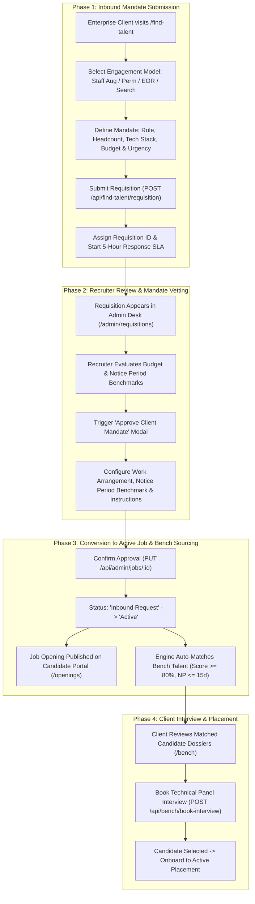

# Enterprise Client Requisition & Talent Intake Workflow

## 1. Overview

The **Client Requisition Workflow** governs how corporate partners specify technical hiring mandates, how ThinkWires validates and approves enterprise orders under a strict 5-Hour SLA benchmark, and how approved orders transition into active job openings and bench matching pipelines.

---

## 2. End-to-End Workflow Architecture

---

## 3. Phase-by-Phase Technical Breakdown

### Phase 1: Inbound Mandate Intake
* **Endpoint**: `POST /api/find-talent/requisition`
* **Rate Limiter**: `publicSubmissionRateLimiter` (30 requests / 15 mins)
* **Frontend View**: `apps/frontend/src/pages/FindTalentPage.jsx`
* **Controller**: `recordInboundRequisition` in `apps/backend/src/controllers/admin.controller.js`
* **Execution Mechanics**:
  1. Captures engagement parameters:
     - **Engagement Model**: Staff Augmentation, Permanent Staffing, EOR, or Executive Search.
     - **Technical Specification**: Target role, headcount, required tech stack, seniority tier.
     - **Delivery Urgency**: Immediate (24-48h), High (within 14 days), or Flexible.
     - **Budget Envelope**: Tier brackets (`bracket_1`: \$5k–\$8k/mo up to `bracket_4`: \$18k+/mo).
     - **Contact Identity**: Hiring manager name, corporate email, company, and phone.
  2. Creates a `JobRequirement` record with `status: 'Inbound Request'`, `isRequisition: true`, and assigns a tracking code (`REQ-XXXXXX`).
  3. Initiates the **5-Hour Candidate Dossier Delivery SLA** timer.

---

### Phase 2: Recruiter Vetting & Triage
* **Component**: `apps/frontend/src/admin/RequisitionsView.jsx`
* **Endpoint**: `GET /api/admin/jobs` (filtered by `isRequisition: true` or `status: 'Inbound Request'`)
* **Guard**: `requireRole('superadmin', 'admin')`
* **Execution Mechanics**:
  1. Requisitions are categorized by priority (`Urgent`, `High`, `Medium`).
  2. Recruiters review requisition parameters against available candidate talent in the pipeline.
  3. Recruiters can directly link an existing corporate `Client` account or provision a new one.

---

### Phase 3: Mandate Approval & Publishing
* **Component**: `apps/frontend/src/admin/RequisitionsView.jsx` (Approve Client Mandate Modal)
* **Endpoint**: `PUT /api/admin/jobs/:id`
* **Execution Mechanics**:
  1. The recruiter designates approval terms:
     - **Approval Status**: `Active` (Mandate Sourcing Active).
     - **Notice Period Benchmark**: Immediate Joiners, $\le 15$ Days, or Serving NP.
     - **Deployment Arrangement**: Remote (Global), Hybrid, or Onsite.
     - **Recruitment Briefing Notes**: Specific sourcing directives for talent scouts.
  2. Updates `JobRequirement.status` to `'Active'`.
  3. The requisition is published to the public candidate openings registry (`/openings`), enabling candidate applications.
  4. Triggers automatic candidate matching against bench engineers with skills overlapping the mandate stack.

---

### Phase 4: Client Interview & Placement Conversion
* **Endpoints**: 
  - `POST /api/bench/book-interview`
  - `POST /api/admin/placements`
* **Execution Mechanics**:
  1. The client reviews anonymized dossiers of matching engineers.
  2. The client submits interview requests specifying desired time slots and technical interviewers.
  3. Recruiter coordinates schedule; upon client hiring confirmation, a formal `Placement` record is initialized with billing and contractor compensation rates.

