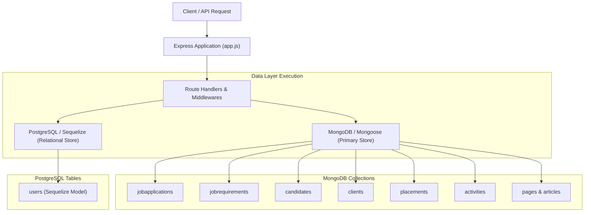
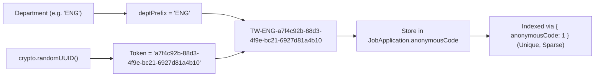

# Database Security, Query Patterns & Architecture Audit

**Target Platform:** ThinkWires Enterprise Talent & ATS Platform (`apps/backend`)  
**Auditor Role:** Principal Software Engineer & Database Security Auditor  
**Scope:** PostgreSQL (Sequelize ORM), MongoDB (Mongoose & Native Driver), Connection Pools, TLS/SSL, Data Migrations, and Query Lifecycle.  
**Classification:** READ-ONLY Security & Performance Audit Documentation  
**Date:** November 2026

---

## 1. Executive Summary & Dual-Persistence Architecture

ThinkWires operates an asymmetric dual-persistence architecture:
1. **Canonical Primary Document Store (MongoDB / Mongoose):** Serves as the source of truth for core recruitment and CMS entities: `JobApplication`, `JobRequirement`, `Candidate`, `Client`, `Placement`, `Employee`, `Article`, `Page`, `Activity`, and `UserMongo`.
2. **Secondary Relational Store (PostgreSQL / Sequelize):** Serves as a relational store for administrative identity synchronization and auditing (`User`).



### Key Audit Findings Overview
- **Injection & Sanitization:** Zero raw SQL concatenations (Sequelize handles parameterization). Zero MongoDB `$where` or JavaScript evaluations. However, **critical mass assignment** exists where raw `req.body` is passed directly to `findOneAndUpdate`.
- **Retrieval Hygiene:** **19 unconstrained `find()` queries** exist across core controllers without `.limit()`, causing severe risk of V8 heap exhaustion (OOM) and database timeouts.
- **Schema Enforcement:** `strict: false` is active in `job.mongo.model.js` and `article.mongo.model.js`, completely bypassing schema enforcement. PostgreSQL lacks formal migration scripts.
- **Connection Security:** `rejectUnauthorized: false` in PostgreSQL connection pooling exposes production cloud traffic to MITM attacks.
- **Indexing & ESR Rule:** Production `autoIndex: false` is enabled without an automated deployment index synchronization pipeline. Hard unique indexing on `JobApplication` permanently breaks application cooldown re-applications.

---

## 2. Structured Findings Matrix

| Finding ID | File Path : Line Number | Severity | Category | Offending Code Pattern |
| :---: | :--- | :---: | :--- | :--- |
| **SEC-DB-01** | [`apps/backend/src/controllers/admin.controller.js:677`](../apps/backend/src/controllers/admin.controller.js#L677) | **CRITICAL** | Retrieval Hygiene (OOM) | `const applications = await JobApplication.find().populate('candidate').sort({ createdAt: -1 }).lean();` |
| **SEC-DB-02** | [`apps/backend/src/controllers/admin.controller.js:1451-1453`](../apps/backend/src/controllers/admin.controller.js#L1451-L1453) | **HIGH** | Mass Assignment / Unvalidated Updates | `const updates = req.body; await Client.findOneAndUpdate(query, updates, { new: true });` |
| **SEC-DB-03** | [`apps/backend/src/routes/api.route.js:460-466`](../apps/backend/src/routes/api.route.js#L460-L466) | **HIGH** | Input Sanitization / Object Spread | `await JobRequirement.findOneAndUpdate({ title: j.title, client: ... }, { ...j, client: ... }, { upsert: true });` |
| **SEC-DB-04** | [`apps/backend/src/controllers/admin.controller.js:1330`](../apps/backend/src/controllers/admin.controller.js#L1330) & [`:1515`](../apps/backend/src/controllers/admin.controller.js#L1515) | **HIGH** | Injection / ReDoS | `{ companyName: { $regex: search, $options: 'i' } }` |
| **SEC-DB-05** | [`apps/backend/src/models/job.mongo.model.js:142`](../apps/backend/src/models/job.mongo.model.js#L142) & [`article.mongo.model.js:105`](../apps/backend/src/models/article.mongo.model.js#L105) | **HIGH** | Schema Enforcement | `{ timestamps: true, strict: false, id: false }` |
| **SEC-DB-06** | [`apps/backend/src/configs/db.js:42`](../apps/backend/src/configs/db.js#L42) | **HIGH** | Connection Security / TLS Verification | `ssl: { require: true, rejectUnauthorized: false }` |
| **SEC-DB-07** | [`apps/backend/src/configs/mongodb.js:28`](../apps/backend/src/configs/mongodb.js#L28) | **HIGH** | Index Lifecycle / Production Silo | `autoIndex: !isProduction` (without automated sync) |
| **SEC-DB-08** | [`apps/backend/src/models/jobApplication.mongo.model.js:321`](../apps/backend/src/models/jobApplication.mongo.model.js#L321) | **HIGH** | Constraint Conflict (Issue #208) | `jobApplicationSchema.index({ candidate: 1, jobId: 1 }, { unique: true });` |
| **SEC-DB-09** | [`apps/backend/src/routes/api.route.js:238`](../apps/backend/src/routes/api.route.js#L238) | **MEDIUM** | Query Efficiency / ESR Violation | `JobRequirement.find({ status: { $in: [...] }, isRequisition: { $ne: true } }).sort({ createdAt: -1 })` |
| **SEC-DB-10** | [`apps/backend/src/routes/articles.route.js:61`](../apps/backend/src/routes/articles.route.js#L61) | **MEDIUM** | Payload Hygiene / Missing Projection | `const dbArticles = await Article.find({ status: 'published' }).sort({ publishedAt: -1, createdAt: -1 })` |
| **SEC-DB-11** | [`apps/backend/src/server.js:26`](../apps/backend/src/server.js#L26) | **MEDIUM** | Relational DDL Discipline | `await sequelize.sync(syncOptions);` |

---

## 3. Deep-Dive Analysis & Remediated Code Implementations

---

### SEC-DB-01: Unbounded In-Memory Collection Hydration in ATS Pipelines
- **Location:** [`apps/backend/src/controllers/admin.controller.js:677`](../apps/backend/src/controllers/admin.controller.js#L677)
- **Impact:** Critical memory leak and Node.js process crash. `JobApplication` documents include full 6-factor AI dossiers (`evaluationReport`), candidate notes, 10 assessment questions, and PII. Loading the entire collection into memory on a single HTTP call exhausts the Node.js V8 heap.
- **Offending Code:**
  ```javascript
  // apps/backend/src/controllers/admin.controller.js:677
  const applications = await JobApplication.find()
    .populate('candidate')
    .sort({ createdAt: -1 })
    .lean();
  ```
- **Remediated Implementation (Keyset Pagination & Lean Projection):**
  ```javascript
  // apps/backend/src/controllers/admin.controller.js:677 (Remediated)
  const pageSize = Math.min(Math.max(parseInt(req.query.limit, 10) || 25, 1), 100);
  const cursorQuery = req.query.cursor
    ? { createdAt: { $lt: new Date(req.query.cursor) } }
    : {};

  const applications = await JobApplication.find(cursorQuery)
    .select(
      'jobTitle department location status firstName lastName email mobileNumber ' +
      'currentEmployer totalExperienceYears createdAt anonymousCode fitScore fitBadge'
    )
    .populate({
      path: 'candidate',
      select: 'name email phone currentRole status experience avatarUrl',
    })
    .sort({ createdAt: -1 })
    .limit(pageSize + 1)
    .lean();

  const hasNextPage = applications.length > pageSize;
  const items = hasNextPage ? applications.slice(0, pageSize) : applications;
  const nextCursor = hasNextPage ? items[items.length - 1].createdAt.toISOString() : null;

  return res.status(200).json({
    success: true,
    applications: items,
    pagination: {
      pageSize,
      hasNextPage,
      nextCursor,
    },
  });
  ```

---

### SEC-DB-02: Mass Assignment & Unvalidated Request Body Passing
- **Location:** [`apps/backend/src/controllers/admin.controller.js:1437-1453`](../apps/backend/src/controllers/admin.controller.js#L1437-L1453)
- **Impact:** An attacker can inject update operators (`$rename`, `$unset`) or overwrite immutable audit timestamps, internal references, and ownership fields.
- **Offending Code:**
  ```javascript
  // apps/backend/src/controllers/admin.controller.js:1437
  const { id } = req.params;
  const updates = req.body;
  ...
  if (isMongoActive()) {
    const query = mongoose.Types.ObjectId.isValid(id) ? { _id: id } : { id };
    await Client.findOneAndUpdate(query, updates, { new: true });
  }
  ```
- **Remediated Implementation (Strict Field Whitelisting):**
  ```javascript
  // apps/backend/src/controllers/admin.controller.js:1437 (Remediated)
  const { id } = req.params;
  const {
    companyName,
    contactPerson,
    email,
    phone,
    industry,
    status,
    location,
    contractType,
  } = req.body;

  const allowedUpdates = {};
  if (companyName !== undefined) allowedUpdates.companyName = String(companyName).trim();
  if (contactPerson !== undefined) allowedUpdates.contactPerson = String(contactPerson).trim();
  if (email !== undefined) allowedUpdates.email = String(email).toLowerCase().trim();
  if (phone !== undefined) allowedUpdates.phone = String(phone).trim();
  if (industry !== undefined) allowedUpdates.industry = String(industry).trim();
  if (status !== undefined) allowedUpdates.status = String(status).trim();
  if (location !== undefined) allowedUpdates.location = String(location).trim();
  if (contractType !== undefined) allowedUpdates.contractType = String(contractType).trim();

  if (isMongoActive()) {
    const query = mongoose.Types.ObjectId.isValid(id) ? { _id: id } : { id };
    const updatedClient = await Client.findOneAndUpdate(
      query,
      { $set: allowedUpdates },
      { new: true, runValidators: true }
    ).lean();

    if (!updatedClient) {
      return res.status(404).json({ success: false, error: 'Client record not found.' });
    }
  }
  ```

---

### SEC-DB-03: Object Spread Injection in Bulk Openings Upsert
- **Location:** [`apps/backend/src/routes/api.route.js:460-466`](../apps/backend/src/routes/api.route.js#L460-L466)
- **Impact:** `{ ...j, client: ... }` spreads unvalidated objects directly into MongoDB update documents.
- **Offending Code:**
  ```javascript
  // apps/backend/src/routes/api.route.js:460-466
  for (const j of req.body.openings) {
    await JobRequirement.findOneAndUpdate(
      { title: j.title, client: j.company || 'Thinkwires Client' },
      { ...j, client: j.company || 'Thinkwires Client' },
      { upsert: true }
    );
  }
  ```
- **Remediated Implementation (Field Sanitization & Atomic $set):**
  ```javascript
  // apps/backend/src/routes/api.route.js:460 (Remediated)
  for (const j of req.body.openings) {
    if (!j.title || typeof j.title !== 'string') continue;

    const sanitizedJob = {
      title: j.title.trim(),
      client: (j.company || j.client || 'Thinkwires Client').trim(),
      category: j.category || 'Technology',
      location: j.location || 'Remote',
      experience: j.experience || '3+ Years',
      salary: j.salary || 'Competitive CTC',
      jobMode: j.jobMode || 'Permanent',
      workMode: j.workMode || 'Remote',
      description: typeof j.description === 'string' ? j.description : '',
      requirements: typeof j.requirements === 'string' ? j.requirements : '',
      skills: Array.isArray(j.skills) ? j.skills : [],
      status: ['Active', 'Approved', 'Published', 'Closed'].includes(j.status)
        ? j.status
        : 'Active',
      isRequisition: false,
    };

    await JobRequirement.findOneAndUpdate(
      { title: sanitizedJob.title, client: sanitizedJob.client },
      { $set: sanitizedJob },
      { upsert: true, new: true, runValidators: true }
    );
  }
  ```

---

### SEC-DB-04: ReDoS in Unsanitized Text Search Queries
- **Location:** [`apps/backend/src/controllers/admin.controller.js:1330`](../apps/backend/src/controllers/admin.controller.js#L1330) & [`:1515`](../apps/backend/src/controllers/admin.controller.js#L1515)
- **Impact:** An attacker passing regex special characters (e.g. `(a+)+$`) triggers exponential backtracking in MongoDB's PCRE engine, pegging CPU at 100%.
- **Offending Code:**
  ```javascript
  // apps/backend/src/controllers/admin.controller.js:1328-1333
  if (search) {
    query.$or = [
      { companyName: { $regex: search, $options: 'i' } },
      { contactPerson: { $regex: search, $options: 'i' } },
      { email: { $regex: search, $options: 'i' } },
    ];
  }
  ```
- **Remediated Implementation (Meta-Character Escaping Utility):**
  ```javascript
  // apps/backend/src/utils/sanitize.util.js
  export const escapeRegex = (str) => {
    if (typeof str !== 'string') return '';
    return str.replace(/[.*+?^${}()|[\]\\]/g, '\\$&').slice(0, 80);
  };

  // apps/backend/src/controllers/admin.controller.js:1328 (Remediated)
  if (search && search.trim()) {
    const safeSearch = escapeRegex(search.trim());
    query.$or = [
      { companyName: { $regex: safeSearch, $options: 'i' } },
      { contactPerson: { $regex: safeSearch, $options: 'i' } },
      { email: { $regex: safeSearch, $options: 'i' } },
    ];
  }
  ```

---

### SEC-DB-05: Schema Enforcement Disabled via `strict: false`
- **Location:** [`apps/backend/src/models/job.mongo.model.js:142`](../apps/backend/src/models/job.mongo.model.js#L142) & [`article.mongo.model.js:105`](../apps/backend/src/models/article.mongo.model.js#L105)
- **Impact:** Disables Mongoose validation for incoming document attributes. Unrecognized keys are saved directly into the database.
- **Offending Code:**
  ```javascript
  // apps/backend/src/models/job.mongo.model.js:140-145
  {
    timestamps: true,
    strict: false,
    id: false,
  }
  ```
- **Remediated Implementation (Strict Schema Typing):**
  ```javascript
  // apps/backend/src/models/job.mongo.model.js:140 (Remediated)
  {
    timestamps: true,
    strict: true,       // Enforce schema integrity; reject undeclared properties
    strictQuery: true,  // Disallow filtering on undeclared keys
    id: false,
  }
  ```

---

### SEC-DB-06: Insecure PostgreSQL TLS Verification Bypass (`rejectUnauthorized: false`)
- **Location:** [`apps/backend/src/configs/db.js:37-45`](../apps/backend/src/configs/db.js#L37-L45)
- **Impact:** Disables certificate authority verification, making database connections vulnerable to Man-in-the-Middle (MITM) credential interception on cloud networks.
- **Offending Code:**
  ```javascript
  // apps/backend/src/configs/db.js:37-45
  ssl: {
    require: true,
    rejectUnauthorized: false,
  }
  ```
- **Remediated Implementation (Strict CA Validation with Fallback):**
  ```javascript
  // apps/backend/src/configs/db.js:37 (Remediated)
  import fs from 'fs';

  const caCertPath = process.env.DB_CA_CERT_PATH;
  const caCert = caCertPath && fs.existsSync(caCertPath)
    ? fs.readFileSync(caCertPath).toString()
    : undefined;

  const sslOptions = enableSsl
    ? {
        ssl: {
          require: true,
          // Reject unauthorized certificates in production unless explicitly overridden by admin config
          rejectUnauthorized: process.env.DB_REJECT_UNAUTHORIZED !== 'false',
          ...(caCert ? { ca: caCert } : {}),
        },
      }
    : {};
  ```

---

### SEC-DB-07: Production Auto-Index Silo
- **Location:** [`apps/backend/src/configs/mongodb.js:28`](../apps/backend/src/configs/mongodb.js#L28)
- **Impact:** Because `autoIndex: false` is active in production, newly declared schema indexes are never built unless triggered by an automated deployment script.
- **Remediated Implementation (Automated Deployment Index Sync Runner):**
  ```javascript
  // apps/backend/src/migrations/syncIndexes.js
  import mongoose from 'mongoose';
  import { connectMongoDB, disconnectMongoDB } from '../configs/mongodb.js';
  import '../models/jobApplication.mongo.model.js';
  import '../models/job.mongo.model.js';
  import '../models/candidate.mongo.model.js';
  import '../models/client.mongo.model.js';
  import '../models/placement.mongo.model.js';
  import '../models/activity.mongo.model.js';
  import '../models/article.mongo.model.js';
  import '../models/page.mongo.model.js';

  export const syncProductionIndexes = async () => {
    try {
      await connectMongoDB();
      console.log('[Migration] Synchronizing production MongoDB indexes...');
      for (const [name, model] of Object.entries(mongoose.models)) {
        await model.syncIndexes();
        console.log(`  ✓ Synced index set for: ${name}`);
      }
      console.log('[Migration] Index synchronization complete.');
    } catch (err) {
      console.error('[Migration] Index sync failed:', err.message);
      throw err;
    } finally {
      await disconnectMongoDB();
    }
  };
  ```

---

### SEC-DB-08: Application Cooldown Conflict in Hard Unique Index
- **Location:** [`apps/backend/src/models/jobApplication.mongo.model.js:321`](../apps/backend/src/models/jobApplication.mongo.model.js#L321)
- **Impact:** Platform Issue #208 established a 90-day cooldown allowing rejected or withdrawn candidates to re-apply. The hard unique index throws `E11000 duplicate key error`, permanently locking out candidate re-applications.
- **Offending Code:**
  ```javascript
  // apps/backend/src/models/jobApplication.mongo.model.js:321
  jobApplicationSchema.index({ candidate: 1, jobId: 1 }, { unique: true });
  ```
- **Remediated Implementation (Partial Unique Index):**
  ```javascript
  // apps/backend/src/models/jobApplication.mongo.model.js:321 (Remediated)
  jobApplicationSchema.index(
    { candidate: 1, jobId: 1 },
    {
      unique: true,
      partialFilterExpression: {
        status: { $in: ['Applied', 'Screening', 'Interview', 'Offered'] },
      },
      name: 'idx_candidate_active_job_unique',
    }
  );
  ```

---

### SEC-DB-09: Query Efficiency & ESR (Equality, Sort, Range) Violation
- **Location:** [`apps/backend/src/routes/api.route.js:238-243`](../apps/backend/src/routes/api.route.js#L238-L243)
- **Impact:** The public job openings query performs an unindexed collection scan and in-memory sort on every visitor page hit.
- **Offending Code:**
  ```javascript
  // apps/backend/src/routes/api.route.js:238
  const dbJobs = await JobRequirement.find({
    status: { $in: ['Active', 'Approved', 'Published'] },
    isRequisition: { $ne: true },
  })
    .sort({ createdAt: -1 })
    .lean();
  ```
- **Remediated Implementation (ESR Compliant Index & Query):**
  1. **ESR Index Definition:**
     ```javascript
     // apps/backend/src/models/job.mongo.model.js
     // E: isRequisition (Equality), S: createdAt (Sort), R: status (Range/In)
     jobRequirementSchema.index(
       { isRequisition: 1, createdAt: -1, status: 1 },
       { name: 'idx_job_openings_esr' }
     );
     ```
  2. **Refactored Query:**
     ```javascript
     // apps/backend/src/routes/api.route.js:238 (Remediated)
     const dbJobs = await JobRequirement.find({
       isRequisition: false,
       status: { $in: ['Active', 'Approved', 'Published'] },
     })
       .sort({ createdAt: -1 })
       .select(
         'jobId title client category badge badgeColor logo location experience ' +
         'salary joining jobMode workMode description requirements skills department postedDate priority'
       )
       .lean();
     ```

---

## 4. UUID-Based Identifier Architecture

To prevent enumeration and scraping on the public Talent Bench dossier API (`GET /api/bench/dossier/:id`), the sequential 3-digit anonymous suffix must be replaced with a cryptographic UUID v4:



### Technical Implementation:
```javascript
// apps/backend/src/controllers/candidatePortal.controller.js:466 (Remediated)
import crypto from 'crypto';

const deptPrefix = (department || 'ENG').substring(0, 3).toUpperCase();
const generatedAnonymousCode = `TW-${deptPrefix}-${crypto.randomUUID()}`;
```
- **Collision Resistance:** $2^{122}$ states guarantee complete global uniqueness.
- **Enumeration Immunity:** Eliminates brute-force scraping of candidate dossiers.

---

## 5. Model-by-Model Indexing Specifications

The following table specifies the complete index set required for optimal database performance:

```markdown
### 1. `JobApplication` (`jobapplications`)
- `{ candidate: 1, jobId: 1 }` (Unique, partialFilterExpression: status in Applied/Screening/Interview/Offered)
- `{ anonymousCode: 1 }` (Unique, sparse)
- `{ candidate: 1, createdAt: -1 }`
- `{ status: 1, createdAt: -1 }`
- `{ resumeUrl: 1 }`

### 2. `JobRequirement` (`jobrequirements`)
- `{ isRequisition: 1, createdAt: -1, status: 1 }` (ESR Compliant for /api/openings)
- `{ isRequisition: 1, status: 1, createdAt: -1 }` (For Admin Requisitions Queue)
- `{ title: 1, client: 1 }` (For Upsert Deduplication)
- `{ jobId: 1 }` (Sparse)

### 3. `Candidate` (`candidates`)
- `{ email: 1 }` (Unique)
- `{ resetPasswordToken: 1 }` (Sparse, for O(1) password reset lookup)
- `{ status: 1, createdAt: -1 }`
- `{ resumeUrl: 1 }`

### 4. `Client` (`clients`)
- `{ email: 1 }` (Unique)
- `{ companyName: 1, status: 1 }`
- `{ createdAt: -1 }`

### 5. `Placement` (`placements`)
- `{ candidateOrEmployeeName: 1, clientName: 1, assignmentStatus: 1 }`
- `{ createdAt: -1 }`

### 6. `Activity` (`activities`)
- `{ entityType: 1, createdAt: -1 }`
- `{ createdAt: -1 }`

### 7. `Article` (`articles`)
- `{ slug: 1 }` (Unique)
- `{ status: 1, publishedAt: -1, createdAt: -1 }`
- `{ articleId: 1 }` (Sparse)

### 8. `Employee` (`employees`)
- `{ email: 1 }` (Unique)
- `{ id: 1 }` (Unique, sparse)
- `{ deploymentStatus: 1 }`
```

---

## 6. Summary of Architectural Recommendations

1. **Implement Relational Migrations for PostgreSQL:** Migrate away from `sequelize.sync({ alter: true })`. Implement Umzug or Sequelize CLI migration scripts to track DDL changes deterministically.
2. **Implement Native `$jsonSchema` Validation:** Configure native collection validators on MongoDB to reject documents violating schema requirements at the engine level.
3. **Standardize Keyset Pagination:** Replace all unbounded `.find()` operations in administrative tables with cursor pagination (`limit` + `cursor`).
4. **Deploy Production Index Sync Script:** Execute `model.syncIndexes()` in the CI/CD deployment pipeline to ensure database clusters maintain all declared indexes.

