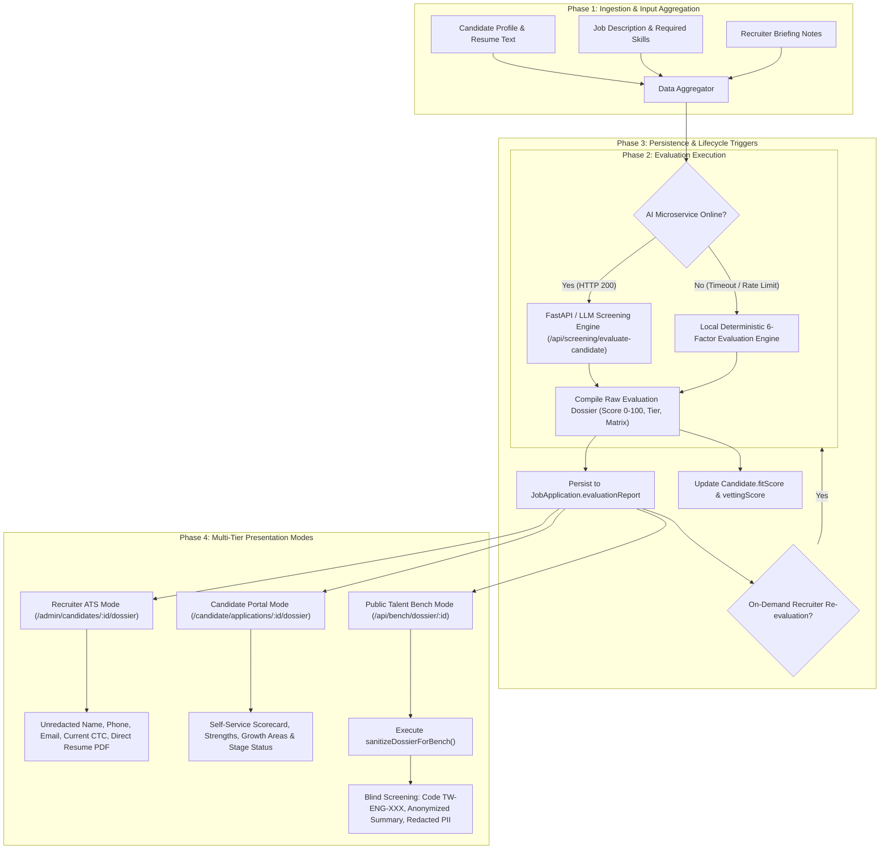

# Candidate Evaluation Dossier Workflow & AI Scoring Engine

## 1. Overview

The **Candidate Evaluation Dossier** is ThinkWires' core technical intelligence asset. It transforms raw candidate profiles, uploaded resumes, and self-reported skills into a standardized, multi-dimensional assessment report used by internal recruiters, candidates, and enterprise hiring clients.

The dossier workflow governs:
1. **Automated AI Synthesis**: Multi-factor evaluation comparing candidate credentials against specific job requisitions.
2. **Fallback Deterministic Engine**: Built-in 6-factor heuristic scoring engine that activates seamlessly if external LLMs hit rate limits or downtime.
3. **Multi-Tier Privacy Views**: Three distinct presentation modes tailored for recruiters (unredacted), candidates (feedback & scorecard), and enterprise clients (blind screening).

---

## 2. End-to-End Dossier Architecture



---

## 3. The 6-Factor AI Evaluation Scoring Engine

When evaluating candidates against a requisition, the engine evaluates six distinct dimensions with calibrated weightings:

| Factor | Weight | Evaluation Criteria |
| :--- | :---: | :--- |
| **1. Mandatory Technical Skills** | **35%** | Analyzes candidate evidence across core stack technologies (including `OR` variants such as `React or Vue`, `AWS / Azure`). Categorized into *Strong Match*, *Partial Match*, or *Missing*. |
| **2. Role & Responsibilities** | **25%** | Matches candidate project history and architectural contributions against target role expectations. |
| **3. Experience & Seniority Tier** | **15%** | Compares verified career duration against target requisition requirements (e.g., Lead $\ge 8\text{ yrs}$, Senior $\ge 5\text{ yrs}$, Mid $\ge 3\text{ yrs}$). |
| **4. Notice Period Alignment** | **10%** | Benchmarks candidate deployment speed against requisition urgency (`Immediate / 15 Days` receives maximum points; `90 Days` is flagged as a delivery risk). |
| **5. Compensation Fit** | **10%** | Compares candidate's `expectedCTC` against client budget envelopes. |
| **6. Cultural & Delivery Dynamics** | **5%** | Evaluates remote readiness, technical articulation, and cross-functional project scale. |

$$\text{Overall Match Score} = \sum_{i=1}^{6} (\text{Factor Score}_i \times \text{Weight}_i)$$

### Scoring Tiers & Hiring Recommendations
* **$\ge 80\%$ $\rightarrow$ Strong Fit**: Automated Recommendation: `SHORTLIST`. Automatically eligible for Talent Cloud Bench syndication.
* **$65\% - 79\%$ $\rightarrow$ Moderate Fit**: Automated Recommendation: `HOLD`. Requires manual recruiter technical interview.
* **$< 65\%$ $\rightarrow$ Below Threshold**: Automated Recommendation: `REJECT` or `REVISE ROLE`.

---

## 4. Dossier Data Schema & Structure

```json
{
  "candidateName": "John Doe",
  "targetRole": "Senior Full-Stack Engineer",
  "overallMatchScore": 88,
  "overallMatchTier": "Strong Fit",
  "recommendation": "SHORTLIST",
  "scorecard": {
    "mandatorySkillsScore": 92,
    "roleAlignmentScore": 85,
    "experienceScore": 90,
    "noticePeriodScore": 100,
    "compensationScore": 80,
    "culturalFitScore": 85
  },
  "executiveSummary": "Candidate demonstrates verified full-lifecycle delivery in modern distributed React and Node.js architectures...",
  "confirmedExperienceSnapshot": [
    "7+ years architecting enterprise SaaS platforms",
    "Proven expertise in PostgreSQL schema optimization and Redis caching",
    "Led microservice decomposition delivering sub-100ms response times"
  ],
  "requirementAlignmentMatrix": [
    {
      "skill": "React",
      "jdRequirement": "Mandatory technical proficiency in React",
      "candidateEvidence": "Demonstrated hands-on experience with REACT across project deliverables",
      "status": "Strong Match",
      "experienceDuration": "5+ Years"
    }
  ],
  "strengths": [
    "High proficiency across core enterprise engineering stack",
    "Immediate availability for deployment (NP <= 15 days)"
  ],
  "gapsAndRisks": [
    "Secondary cloud exposure in GCP rather than primary AWS specification"
  ],
  "clientSubmissionSummary": "Ready for direct enterprise technical panel interview.",
  "evaluatedAt": "2026-11-02T19:00:00.000Z"
}
```

---

## 5. Multi-Tier Presentation Modes

The platform enforces strict role-based separation on how dossiers are presented:

### Mode 1: Recruiter / Admin View (Unredacted)
* **Access**: `superadmin`, `admin`
* **Endpoint**: `GET /api/admin/candidates/:id/dossier`
* **Component**: `apps/frontend/src/admin/CandidateEvaluationModal.jsx`
* **Capabilities**:
  - Full candidate identity (legal name, phone, email, current employer, current compensation).
  - Direct verified resume PDF download button.
  - Recruiter notes input area with on-demand AI re-evaluation (`POST /api/admin/candidates/:id/re-evaluate`).
  - Pipeline status promotion dropdown (`Applied` $\rightarrow$ `Interview` $\rightarrow$ `Offered`).

### Mode 2: Candidate Self-Service View (Candidate Portal)
* **Access**: Authenticated owning candidate (`requireCandidateAuth`)
* **Endpoint**: `GET /api/candidate/applications/:id/dossier`
* **Component**: `apps/frontend/src/components/candidate/CandidateDossierModal.jsx`
* **Capabilities**:
  - Displays match score, fit badge, and radar scorecard.
  - Highlights engineering strengths and constructive growth areas.
  - Provides objective clarity on their application stage without exposing client billing rates or internal recruiter notes.

### Mode 3: Public Talent Bench View (Blind Screening)
* **Access**: Public enterprise hiring clients and visitors
* **Endpoint**: `GET /api/bench/dossier/:id`
* **Component**: `apps/frontend/src/components/BenchComponents/BenchDossierDrawer.jsx`
* **Transform Function**: `sanitizeDossierForBench(dossier, anonymousCode, targetRole)`
* **Sanitization Safeguards**:
  - **Zero PII**: Replaces legal candidate names with anonymous identifiers (e.g. `Candidate TW-ENG-412`).
  - **Company Redaction**: Removes former employer names to prevent backchannel hiring.
  - **Financial Privacy**: Filters out internal compensation gaps and current salary notes.
  - **Blind Evaluation**: Focuses enterprise clients strictly on verified code competency, architectural strengths, and availability.

