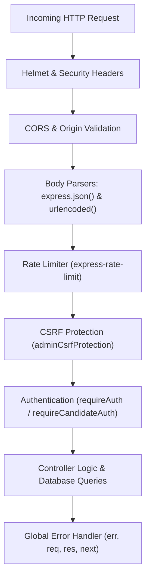

# Express.js Backend Security & Architecture Audit

**Target Workspace:** `apps/backend` (Express.js, Mongoose MongoDB, Sequelize PostgreSQL, Upstash Redis)  
**Auditor Role:** Principal Node.js Architect & Security Engineer  
**Scope:** Express Runtime, Middleware Chaining, Async Process Safety, Body Parsing, NoSQL Injection, Connection Lifecycles, and Graceful Shutdown.  
**Classification:** READ-ONLY Security, Performance & Architecture Audit  
**Date:** November 2026

---

## 1. Executive Summary & Runtime Architecture

A rigorous static code audit of the Express.js backend was conducted across `app.js`, `server.js`, route definitions, controllers, and middlewares.

### Key Architectural Findings:
1. **Express Version:** The backend runs **Express 5.3.0** (`^5.2.1`). Express 5 automatically catches rejected promises in async route handlers and forwards them to the global error handler (`next(err)`), eliminating the Express 4 requirement for `express-async-errors` or manual `asyncHandler` wrappers.
2. **Critical NoSQL Query Selector Injection:** The application uses `express.urlencoded({ extended: true })` and reads nested query parameters without validation. Attackers can pass object payloads like `?status[$ne]=Rejected` or `?email[$regex]=^admin`, which are passed directly into MongoDB query filters (`Candidate.find(query)`, `Client.find(query)`), bypassing business rules and leaking data.
3. **Mass Assignment in MongoDB Updates:** Direct passing of `req.body` into `Client.findOneAndUpdate(query, req.body)` and uncontrolled object spreading `{ ...j }` in `JobRequirement.findOneAndUpdate` permits arbitrary database modification.
4. **Denial of Service via 10 MB JSON Body Limit:** `express.json({ limit: '10mb' })` allows multi-megabyte JSON payloads, enabling trivial JSON parsing ReDoS/DoS that freezes Node's single-threaded event loop.
5. **Information Leakage in Production Error Responses:** The global error handler and dozens of controller catch blocks return `res.status(500).json({ error: err.message })`, leaking internal database driver errors, collection names, and file paths.
6. **Missing Process Exception Monitors:** Neither `server.js` nor `app.js` registers handlers for `unhandledRejection` or `uncaughtException`, allowing unhandled asynchronous background promises to crash the Node process.



---

## 2. Structured Findings Matrix

| Finding ID | File Path : Line Number | Category | Severity | Risk & Impact |
| :---: | :--- | :--- | :---: | :--- |
| **SEC-EXP-01** | [`apps/backend/src/controllers/admin.controller.js:672`](../apps/backend/src/controllers/admin.controller.js#L672) & [`:1336`](../apps/backend/src/controllers/admin.controller.js#L1336) | Input Validation / Injection | **CRITICAL** | **NoSQL Injection via Query Objects:** Unvalidated `req.query.status` accepts nested query selectors (e.g. `[$ne]=`) directly into MongoDB filters. |
| **SEC-EXP-02** | [`apps/backend/src/controllers/admin.controller.js:1437-1452`](../apps/backend/src/controllers/admin.controller.js#L1437-L1452) | Parameter Tampering / Mass Assignment | **HIGH** | **Direct `req.body` Passing to `findOneAndUpdate`:** Raw request body passed to MongoDB driver without schema filtering or sanitization. |
| **SEC-EXP-03** | [`apps/backend/src/app.js:64-65`](../apps/backend/src/app.js#L64-L65) | Security Hardening / DoS | **HIGH** | **Excessive Body Parser Limit (10MB):** `express.json({ limit: '10mb' })` allows multi-megabyte JSON payloads that freeze the event loop. |
| **SEC-EXP-04** | [`apps/backend/src/app.js:168-177`](../apps/backend/src/app.js#L168-L177) | Process Safety / Info Leakage | **HIGH** | **Production Information Leakage:** Global error handler returns `err.message` unconditionally, leaking internal database stack details. |
| **SEC-EXP-05** | [`apps/backend/src/server.js:68-96`](../apps/backend/src/server.js#L68-L96) | Process Lifecycle | **HIGH** | **Missing Unhandled Rejection Listeners:** No `unhandledRejection` or `uncaughtException` monitors registered in `server.js`. |
| **SEC-EXP-06** | [`apps/backend/src/routes/api.route.js:455-474`](../apps/backend/src/routes/api.route.js#L455-L474) | Middleware Order / RBAC | **HIGH** | **Alternate Route Privilege Escalation:** `POST /api/openings` uses `requireAuth(['superadmin', 'admin', 'cms_admin'])`, allowing `cms_admin` to upsert jobs. |
| **SEC-EXP-07** | [`apps/backend/src/configs/db.js:42`](../apps/backend/src/configs/db.js#L42) | Connection Security | **HIGH** | **TLS Verification Bypass:** PostgreSQL connection pool uses `rejectUnauthorized: false`, permitting MITM interception on cloud networks. |
| **SEC-EXP-08** | [`apps/backend/src/models/job.mongo.model.js:142`](../apps/backend/src/models/job.mongo.model.js#L142) | Schema Integrity | **HIGH** | **Unrestricted Document Schemas:** `strict: false` disables Mongoose attribute validation, permitting arbitrary property injection. |
| **SEC-EXP-09** | [`apps/backend/src/configs/mongodb.js:28`](../apps/backend/src/configs/mongodb.js#L28) | Index Lifecycle | **MEDIUM** | **Unsynchronized Production Indexes:** `autoIndex: false` in production without an automated index migration runner. |

---

## 3. In-Depth Root Cause Analysis & Production-Grade Fixes

---

### SEC-EXP-01: NoSQL Query Selector Injection via Unsanitized Query Objects
- **Location:** [`apps/backend/src/controllers/admin.controller.js:672`](../apps/backend/src/controllers/admin.controller.js#L672) & [`:1336`](../apps/backend/src/controllers/admin.controller.js#L1336)
- **Root Cause:**
  `express.urlencoded({ extended: true })` uses the `qs` library. When a client sends `?status[$ne]=Rejected`, `req.query.status` is parsed as an object `{ "$ne": "Rejected" }`. In `getCandidates` and `getClients`, the controller directly assigns:
  ```javascript
  if (status && status !== 'All') query.status = status;
  ```
  This passes the operator object directly to MongoDB: `Candidate.find({ status: { $ne: 'Rejected' } })`. An attacker can manipulate filter logic, enumerate records, or bypass status gates.
- **Offending Code:**
  ```javascript
  // apps/backend/src/controllers/admin.controller.js:672
  const { search, status } = req.query;
  ...
  if (status && status !== 'All') query.status = status;
  ```
- **Remediated Implementation (Strict Type Assertion & Query Sanitizer):**
  ```javascript
  // apps/backend/src/middlewares/sanitize.middleware.js (New Utility Middleware)
  export const sanitizeQueryScalars = (req, res, next) => {
    // Recursively strip any key starting with '$' or containing '.'
    const sanitize = (obj) => {
      if (!obj || typeof obj !== 'object') return obj;
      for (const key of Object.keys(obj)) {
        if (key.startsWith('$') || key.includes('.')) {
          delete obj[key];
        } else if (typeof obj[key] === 'object') {
          sanitize(obj[key]);
        }
      }
      return obj;
    };

    req.query = sanitize(req.query);
    req.body = sanitize(req.body);
    req.params = sanitize(req.params);
    next();
  };

  // apps/backend/src/controllers/admin.controller.js:672 (Remediated)
  const statusParam = typeof req.query.status === 'string' ? req.query.status.trim() : null;
  const ALLOWED_STATUSES = ['Applied', 'Screening', 'Interview', 'Offered', 'Hired', 'Rejected', 'Withdrawn'];

  if (statusParam && statusParam !== 'All' && ALLOWED_STATUSES.includes(statusParam)) {
    query.status = statusParam;
  }
  ```

---

### SEC-EXP-02: Mass Assignment in MongoDB Update Operations
- **Location:** [`apps/backend/src/controllers/admin.controller.js:1437-1453`](../apps/backend/src/controllers/admin.controller.js#L1437-L1453)
- **Root Cause:**
  Passing raw `req.body` directly to `findOneAndUpdate` without whitelisting allows malicious callers to overwrite unexposed fields or inject atomic operators (`$set`, `$unset`, `$rename`).
- **Offending Code:**
  ```javascript
  // apps/backend/src/controllers/admin.controller.js:1437
  const updates = req.body;
  ...
  await Client.findOneAndUpdate(query, updates, { new: true });
  ```
- **Remediated Implementation (Explicit Whitelist & Atomic `$set`):**
  ```javascript
  // apps/backend/src/controllers/admin.controller.js:1437 (Remediated)
  const { id } = req.params;
  const {
    companyName,
    contactPerson,
    email,
    phone,
    industry,
    status,
    location,
    contractType,
  } = req.body;

  const safeUpdates = {};
  if (companyName !== undefined) safeUpdates.companyName = String(companyName).trim();
  if (contactPerson !== undefined) safeUpdates.contactPerson = String(contactPerson).trim();
  if (email !== undefined) safeUpdates.email = String(email).toLowerCase().trim();
  if (phone !== undefined) safeUpdates.phone = String(phone).trim();
  if (industry !== undefined) safeUpdates.industry = String(industry).trim();
  if (status !== undefined) safeUpdates.status = String(status).trim();
  if (location !== undefined) safeUpdates.location = String(location).trim();
  if (contractType !== undefined) safeUpdates.contractType = String(contractType).trim();

  if (isMongoActive()) {
    const query = mongoose.Types.ObjectId.isValid(id) ? { _id: id } : { id };
    await Client.findOneAndUpdate(
      query,
      { $set: safeUpdates },
      { new: true, runValidators: true }
    );
  }
  ```

---

### SEC-EXP-03: Denial of Service via 10 MB JSON Body Limit
- **Location:** [`apps/backend/src/app.js:64-65`](../apps/backend/src/app.js#L64-L65)
- **Root Cause:**
  `app.use(express.json({ limit: '10mb' }))` permits 10 MB JSON payloads. Parsing a 10 MB JSON string blocks the V8 event loop for 200–500 ms. A burst of requests causes thread starvation, 504 gateway timeouts, and server crashes. Multipart file uploads are handled separately via `multer`, making a 10 MB JSON limit completely unnecessary.
- **Offending Code:**
  ```javascript
  // apps/backend/src/app.js:64-65
  app.use(express.json({ limit: '10mb' }));
  app.use(express.urlencoded({ extended: true, limit: '10mb' }));
  ```
- **Remediated Implementation (Strict Production Body Limits):**
  ```javascript
  // apps/backend/src/app.js:64-65 (Remediated)
  app.use(express.json({ limit: '200kb' })); // Standard REST payloads never exceed 200kb
  app.use(express.urlencoded({ extended: true, limit: '200kb' }));
  ```

---

### SEC-EXP-04: Information Leakage in Global Error Middleware
- **Location:** [`apps/backend/src/app.js:168-177`](../apps/backend/src/app.js#L168-L177)
- **Root Cause:**
  `res.status(err.status || 500).json({ error: err.message })` exposes internal driver error strings (e.g. `MongoServerError: connection <monitor> to shard-00... closed`, Mongoose validation details containing collection names and file paths).
- **Offending Code:**
  ```javascript
  // apps/backend/src/app.js:168-177
  app.use((err, req, res, next) => {
    console.error('[Unhandled API Error]:', err);
    if (res.headersSent) {
      return next(err);
    }
    res.status(err.status || 500).json({
      success: false,
      error: err.message || 'Internal Server Error',
    });
  });
  ```
- **Remediated Implementation (Environment-Aware Sanitized Error Responder):**
  ```javascript
  // apps/backend/src/middlewares/errorHandler.middleware.js (Remediated)
  export const errorHandler = (err, req, res, next) => {
    const isProduction = process.env.NODE_ENV === 'production';
    const statusCode = err.status || err.statusCode || 500;

    // Log complete error and stack trace server-side for observability
    console.error(`[API Error ${statusCode}] ${req.method} ${req.originalUrl}:`, {
      message: err.message,
      stack: isProduction ? undefined : err.stack,
    });

    if (res.headersSent) {
      return next(err);
    }

    // Mask internal 5xx errors in production; only return user-friendly messages for 4xx errors
    let userFacingMessage = err.message || 'Internal Server Error';
    if (isProduction && statusCode >= 500) {
      userFacingMessage = 'An unexpected server error occurred. Please contact Thinkwires support.';
    }

    res.status(statusCode).json({
      success: false,
      error: userFacingMessage,
      ...(isProduction ? {} : { stack: err.stack }),
    });
  };
  ```

---

### SEC-EXP-05: Missing Process-Level Unhandled Rejection Monitors
- **Location:** [`apps/backend/src/server.js:68-96`](../apps/backend/src/server.js#L68-L96)
- **Root Cause:**
  Node.js terminates processes on unhandled promise rejections if no listener is attached. Background tasks (e.g., mail dispatch, async activity logging) running outside the request-response lifecycle can crash the container if a promise fails without a catch handler.
- **Offending Code:**
  `server.js` only registers `SIGTERM` and `SIGINT`. No `unhandledRejection` or `uncaughtException` listeners exist.
- **Remediated Implementation (Process Safety Harness):**
  ```javascript
  // apps/backend/src/server.js (Remediated Process Lifecycle Setup)
  process.on('unhandledRejection', (reason, promise) => {
    console.error('🚨 [Process] Unhandled Promise Rejection at:', promise, 'reason:', reason);
    // Log telemetry to error tracker (e.g. Sentry/Datadog) without crashing active web server
  });

  process.on('uncaughtException', (error) => {
    console.error('💥 [Process] Critical Uncaught Exception:', error);
    // Uncaught exceptions leave process memory in an undefined state; initiate controlled exit
    gracefulShutdown('UNCAUGHT_EXCEPTION', 1);
  });
  ```

---

## 4. Production-Grade Foundational Boilerplate

### 4.1 Production Graceful Shutdown Harness (`server.js`)
```javascript
// apps/backend/src/server.js (Complete Production Harness)
import app from './app.js';
import { connectDB, sequelize } from './configs/db.js';
import { connectMongoDB, disconnectMongoDB } from './configs/mongodb.js';
import config from './configs/dotenv.js';
import { getRedisClient, closeRedis } from './configs/redis.js';

const PORT = config.PORT || 5000;

const startServer = async () => {
  const server = app.listen(PORT, () => {
    console.log(`[Server] Thinkwires API server running on port ${PORT}`);
  });

  // Database initialization
  await connectMongoDB().catch((e) => console.warn('[MongoDB] Init notice:', e.message));
  await connectDB().catch((e) => console.warn('[PostgreSQL] Init notice:', e.message));
  await getRedisClient().catch((e) => console.warn('[Redis] Init notice:', e.message));

  const gracefulShutdown = (signal, exitCode = 0) => {
    console.log(`[Server] Received ${signal}. Draining active connections...`);

    // Stop accepting new connections
    server.close(async () => {
      console.log('[Server] Active HTTP sockets drained and closed.');
      try {
        await disconnectMongoDB();
        console.log('[MongoDB] Connection pool closed.');

        if (sequelize) {
          await sequelize.close();
          console.log('[PostgreSQL] Connection pool closed.');
        }

        await closeRedis();
        console.log('[Redis] Client disconnected.');
      } catch (err) {
        console.error('[Server] Error during teardown:', err.message);
      }
      process.exit(exitCode);
    });

    // Hard timeout fallback if active requests hang
    setTimeout(() => {
      console.error('[Server] Teardown timeout exceeded (10s). Forcing process exit.');
      process.exit(1);
    }, 10000).unref();
  };

  // Process-level monitors
  process.on('unhandledRejection', (reason) => {
    console.error('🚨 [Process] Unhandled Rejection:', reason);
  });

  process.on('uncaughtException', (err) => {
    console.error('💥 [Process] Uncaught Exception:', err);
    gracefulShutdown('UNCAUGHT_EXCEPTION', 1);
  });

  process.once('SIGTERM', () => gracefulShutdown('SIGTERM', 0));
  process.once('SIGINT', () => gracefulShutdown('SIGINT', 0));

  return server;
};

startServer();
```

---

### 4.2 Centralized Request Sanitizer Middleware (`sanitize.middleware.js`)
```javascript
// apps/backend/src/middlewares/sanitize.middleware.js
export const sanitizeInputs = (req, res, next) => {
  const sanitize = (data) => {
    if (!data || typeof data !== 'object') return data;
    if (Array.isArray(data)) return data.map(sanitize);

    const clean = {};
    for (const [key, val] of Object.entries(data)) {
      // Disallow MongoDB operators ($where, $ne, $regex) and dotted properties
      if (key.startsWith('$') || key.includes('.')) {
        continue;
      }
      clean[key] = typeof val === 'object' ? sanitize(val) : val;
    }
    return clean;
  };

  if (req.body) req.body = sanitize(req.body);
  if (req.query) req.query = sanitize(req.query);
  if (req.params) req.params = sanitize(req.params);

  next();
};
```

---

## 5. Architectural Recommendations & Remediation Checklist

1. **Mount Request Sanitizer Early:** Mount `sanitizeInputs` immediately after `express.json()` in `app.js` to strip `$`-prefixed operators globally across all routes.
2. **Reduce Body Parser Limits to 200 KB:** Change `express.json({ limit: '10mb' })` to `express.json({ limit: '200kb' })`. Large file uploads must be handled via `multer` disk streaming.
3. **Deploy Environment-Aware Error Handler:** Replace the error middleware in `app.js` with the production-safe `errorHandler` that masks 5xx internal driver errors.
4. **Attach Top-Level Process Listeners:** Add `process.on('unhandledRejection')` and `process.on('uncaughtException')` to `server.js`.
5. **Enforce Strict Role Guards on Public API Routes:** Replace `adminAuthGuard = requireAuth(['superadmin', 'admin', 'cms_admin'])` on `/api/openings` with `requireRole('superadmin', 'admin')` to block CMS Admin tampering.

