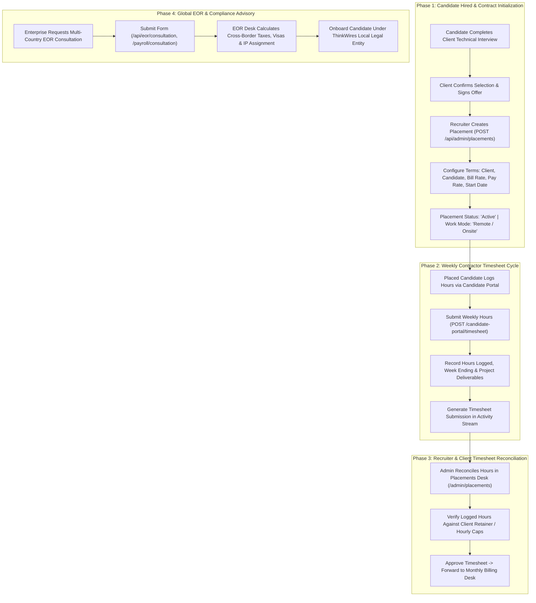

# Placements, Timesheets & Global Workforce Workflow

## 1. Overview

The **Placement and Workforce Operations Workflow** governs post-hiring operations at ThinkWires. It spans contract initiation upon candidate hire, billing/pay rate reconciliation, weekly developer timesheet logging, client timesheet approval desk, and multi-country Employer of Record (EOR) advisory operations.

---

## 2. End-to-End Workflow Architecture

---

## 3. Phase-by-Phase Technical Breakdown

### Phase 1: Placement Contract Provisioning
* **Endpoints**: 
  - `GET /api/admin/placements`
  - `POST /api/admin/placements`
  - `PUT /api/admin/placements/:id`
  - `DELETE /api/admin/placements/:id`
* **Component**: `apps/frontend/src/admin/PlacementsView.jsx`
* **Guard**: `requireRole('superadmin', 'admin')`
* **Model**: `Placement` (`apps/backend/src/models/placement.mongo.model.js`)
* **Execution Mechanics**:
  1. Once an enterprise interview is successful, the recruiter initializes a `Placement` record with:
     - **Candidate Reference**: Name, contact email, and original application ID.
     - **Enterprise Client Reference**: Client company name and hiring manager.
     - **Financial Terms**: Client billing rate (e.g. \$85/hr or \$12,000/mo) and candidate contractor payout rate (e.g. \$60/hr or \$8,500/mo).
     - **Timeline**: Contract start date, expected tenure (e.g., 6 months renewable), and deployment work arrangement (Remote Global, Hybrid, or Onsite).
  2. Updates candidate status in the master directory to `'Placed'`.

---

### Phase 2: Weekly Developer Timesheet Intake
* **Endpoint**: `POST /api/candidate-portal/timesheet`
* **Component**: `apps/frontend/src/pages/CandidatePortalPage.jsx` (`CandidatePayoutAndCompliance.jsx`)
* **Execution Mechanics**:
  1. Placed engineers log weekly productive hours (standard 40 hours/week cap).
  2. Submits billable week ending date and optional project notes/milestone accomplishments.
  3. The backend logs the submission to the internal audit pipeline (`Activity.create`) tagged with green status badge (`#16A34A`), notifying the operations desk.

---

### Phase 3: Financial Reconciliation & Invoicing Desk
* **Component**: `apps/frontend/src/admin/PlacementsView.jsx`
* **Execution Mechanics**:
  1. The recruitment operations desk tracks active contracts, total deployed talent, and fulfilled headcount against active enterprise quotas.
  2. Automatic margin calculation:
     $$\text{Gross Margin} = \text{Client Bill Rate} - \text{Candidate Pay Rate}$$
  3. Reconciled timesheets trigger automatic invoice generation for corporate clients.

---

### Phase 4: Global EOR & Permanent Staffing Consultations
* **Endpoints**:
  - `POST /api/eor/consultation`
  - `POST /api/payroll/consultation`
  - `POST /api/permanent-staffing/consultation`
  - `POST /api/executive-search/consultation`
* **Rate Limiter**: `publicSubmissionRateLimiter` (30 requests / 15 mins)
* **Execution Mechanics**:
  1. Enterprise clients looking to hire talent across borders submit consultation requests for legal compliance, benefits, and local statutory filings.
  2. ThinkWires EOR specialists calculate local tax withholdings, statutory benefits (e.g., health, pension), and intellectual property assignment under local jurisdiction laws.
  3. Enables enterprise clients to deploy software engineers worldwide without establishing foreign legal entities.

