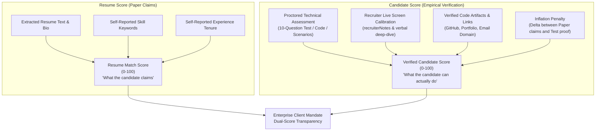

Ran search scoring fields in backend
Analyzed candidatePortal.controller.js:L890-945
Ran search evaluateAssessment in ai.service.js
Analyzed ai.service.js:L359-420
Ran find fallbackEvaluateAssessment
Analyzed ai.service.js:L1022-1065
Analyzed screening.py:L1-35

You have highlighted a crucial reality in modern hiring and enterprise staffing:

> **The "Resume Inflation" Problem**: With ChatGPT, Claude, and ATS optimization tools, any candidate can generate an impeccably formatted resume stuffed with exact job keywords that scores 95%+ on keyword match algorithms, without possessing the actual engineering depth to deliver in production.

To solve this, ThinkWires provides a **Dual-Score Architecture**: separating what the candidate **claims on paper** from what the candidate **empirically proves in practice**.

---

## 1. Resume Score vs. Candidate Score: The Core Distinction



| Dimension            | **Resume Score** (`resumeScore` / `fitScore`)                    | **Candidate Score** (`candidateScore` / `vettingScore`)                           |
| :------------------- | :--------------------------------------------------------------- | :-------------------------------------------------------------------------------- |
| **Source Data**      | PDF/DOCX Resume, candidate cover letter, listed skills.          | Timed proctored test, recruiter interview, code proof, live calibration.          |
| **Gameability**      | **High** (Easily generated with AI prompt optimization).         | **Near Zero** (Requires solving timed problems and passing technical interviews). |
| **Primary Question** | _"Does their resume align with the Job Description?"_            | _"Can this candidate actually build and deliver in production?"_                  |
| **Current Field**    | `JobApplication.fitScore` / `evaluationReport.overallMatchScore` | `JobApplication.assessmentScore` + `Candidate.vettingScore`                       |

---

## 2. How to Get the Candidate Score in ThinkWires

The ThinkWires codebase already possesses the foundational building blocks to calculate a verified **Candidate Score**. Here is the mathematical and architectural formula to derive it:

$$\text{Candidate Score} = (0.50 \times \text{Assessment}) + (0.25 \times \text{Recruiter Screen}) + (0.15 \times \text{Artifacts}) - \text{Inflation Penalty}$$

### Pillar 1: Proctored Technical Screening Assessment (50% Weight)

- **Where it runs**: [`apps/backend/src/controllers/candidatePortal.controller.js:890-940`](file:///c:/Users/Tanjil%20Alam/Desktop/ThinkWires/thinkwires/apps/backend/src/controllers/candidatePortal.controller.js#L890-L940) (`submitApplicationAssessment`) backed by `aiService.evaluateAssessment()`.
- **How it works**:
  1. When a candidate applies, `aiService.generateAssessment()` dynamically synthesizes a **10-question timed assessment** customized to the job's tech stack (MCQs, systems architecture scenarios, and debugging questions).
  2. The candidate completes the test in the Candidate Portal (`/candidate-portal/assessment/:id`).
  3. The evaluator deterministically grades each answer and produces `evalResult.total_score` (0–100), saved into `JobApplication.assessmentScore`.
- **Why it cannot be faked**: The questions are generated per mandate with randomize-on-demand parameters and time limits.

### Pillar 2: Recruiter Live Calibration & Verification (25% Weight)

- **Where it runs**: [`apps/backend/src/controllers/admin.controller.js:950-1005`](file:///c:/Users/Tanjil%20Alam/Desktop/ThinkWires/thinkwires/apps/backend/src/controllers/admin.controller.js#L950-L1005) (`reEvaluateCandidate`).
- **How it works**:
  1. The staffing director conducts a 15-minute phone screen using the **Targeted Recruiter Screening Questions** generated in the AI Dossier.
  2. The recruiter enters qualitative notes into `POST /api/admin/candidates/:id/re-evaluate` (`recruiterNotes`).
  3. The engine parses the recruiter's feedback (communication clarity, depth of project ownership, truthfulness of architecture claims) and updates the score.

### Pillar 3: Verified Artifacts & History (15% Weight)

- **Where it runs**: [`pricing.utils.js`](file:///c:/Users/Tanjil%20Alam/Desktop/ThinkWires/thinkwires/apps/backend/src/utils/pricing.utils.js) and `candidatePortal.controller.js`.
- **How it works**:
  - Verification of public GitHub repositories / commit histories (`sanitizeSafeUrl(githubUrl)`).
  - Validation of current employer tenure and notice period (`parseNoticeDays(noticePeriod)`).
  - Verification of professional corporate references and email identity.

### Pillar 4: The Resume Inflation Penalty (Divergence Guard)

- **The Formula**:
  $$\text{Divergence} = \max(0, \text{Resume Score} - \text{Assessment Score})$$
- **The Rule**: If a resume claims a **96% match** on paper, but the candidate only scores **50%** on the live proctored screening test, the engine flags a **High Inflation Risk** ($\Delta = 46$) and applies a 10-point penalty to the candidate score.
- Conversely, if a candidate has an unpolished resume (72% match) but achieves **95%** on the technical assessment, their candidate score is boosted to reflect genuine talent.

---

## 3. Recommended Code Specification: Dual-Score Model

To formally provide both scores across the API, Admin ATS, and Client Dossier, we can structure the scoring payload in `JobApplication` and `Candidate` models as follows:

```javascript
// Dual-Score Architecture Schema
scores: {
  // 1. Resume Score (Paper / Claimed)
  resumeScore: {
    score: 92,
    tier: 'Strong Fit (Paper)',
    skillsMatch: 95,
    experienceMatch: 90,
    basis: 'Static Resume & JD Parsing',
  },

  // 2. Candidate Score (Verified / Practical)
  candidateScore: {
    score: 86,
    tier: 'Verified Talent',
    assessmentScore: 88,          // Proctored technical test
    recruiterScreenScore: 84,     // Recruiter live calibration
    verifiedArtifactsScore: 85,   // GitHub / portfolio audit
    inflationRisk: 'Low',          // Delta: 6 points
    basis: 'Proctored Assessment + Staffing Screen',
  },

  // Consolidated Index
  compositeVettingScore: 88,
  isVetted: true, // Only true when proctored test >= 75%
}
```

---

## 4. How the Scores Appear Across ThinkWires

1. **For Enterprise Clients (Talent Bench & Mandate Dossiers)**:
   - Displays both metrics side-by-side:
     - **`Resume Match`**: `92%` (Shows mandate keyword coverage).
     - **`Verified Talent Score`**: `86%` (Proves hands-on technical execution).
   - Highlighting the verified score builds client trust because enterprise sponsors know ThinkWires doesn't just forward keyword-matched resumes.
2. **For Recruiters (Admin ATS)**:
   - Identifies candidate red flags immediately: _"Resume Score 95% vs. Test Score 42% — High AI Embellishment Risk"_.
3. **For Candidates (Candidate Portal)**:
   - Motivates candidates to complete the screening assessment: _"Your resume match is 85%. Take the 15-minute technical assessment to boost your Candidate Score and get shortlisted for client interviews."_

This dual-score strategy eliminates reliance on static resumes and delivers authentic, high-signal candidates to clients.

Ran check assessment fields in JobApplication model
Analyzed jobApplication.mongo.model.js:L245-300
Analyzed candidatePortal.controller.js:L915-960
Analyzed test_generator.py:L1-80
Analyzed test_evaluator.py:L1-80

To provide full transparency to enterprise clients and recruiters, the dossier cannot present a single generic percentage. It must clearly separate the **Resume Score (Paper Claims)** from the **Candidate Score (Proctored Proof)**, and include an **Itemized Assessment Audit Sheet** detailing the exact questions the candidate answered.

Here is the exact architectural and visual specification of how the dossier reflects this data.

---

## 1. Dual-Score Header in the Dossier

At the top of the dossier, the candidate is presented with two independent, clearly labeled scorecards rather than a single blended number:

```
┌─────────────────────────────────────────┐  ┌─────────────────────────────────────────┐
│           RESUME MATCH SCORE            │  │         VERIFIED CANDIDATE SCORE        │
│                  92%                    │  │                   85%                   │
│   Claimed Fit & Keyword Coverage        │  │   Live Proctored Technical Assessment   │
├─────────────────────────────────────────┤  ├─────────────────────────────────────────┤
│ • Mandatory Skills on Paper: 95%        │  │ • Proctored Assessment: 85/100 (PASSED) │
│ • Claimed Industry Tenure: 5+ Years     │  │ • 7x MCQs: 60/70 pts                   │
│ • Role & Responsibility Match: 88%      │  │ • 2x System Design Scenarios: 15/20 pts │
│ • Source: Static Resume & JD Analysis   │  │ • 1x Practical Implementation: 10/10 pts│
│ • Verification Status: UNVERIFIED CLAIM │  │ • Verification Status: VERIFIED PROOF   │
└─────────────────────────────────────────┘  └─────────────────────────────────────────┘
        ▲                                                      ▲
        │                                                      │
Static parsing of PDF/DOCX claims                  Empirically graded timed exam
```

### Divergence & Integrity Index:

The dossier highlights the relationship between both scores:

> **Integrity Verification: High Alignment ($\Delta = 7\%$)**  
> _The candidate's live proctored technical performance ($85\%$) confirms the engineering capabilities claimed on their resume ($92\%$). Low risk of AI resume embellishment._

---

## 2. Itemized Question-by-Question Assessment Audit

Directly below the high-level metrics, the dossier contains a dedicated **"Proctored Technical Assessment Breakdown"** section. This allows client engineering leads and hiring managers to review the exact test administered, the questions asked, and how the candidate answered:

### Section Preview in Client Dossier:

#### Assessment Telemetry & Metadata

- **Assessment ID**: `eval_react_node_arch_9021`
- **Target Stack**: React, TypeScript, Node.js, PostgreSQL System Design
- **Time Spent**: 14 minutes (out of 20-minute proctored limit)
- **Passing Threshold**: 75% | **Candidate Result**: **85% (PASSED)**

---

### Question-by-Question Audit Table

|    #    | Type                | Question Prompt                                                                                                                                     | Candidate Answer & Result                                                                                                                                                                                                                                                                          |    Score    |
| :-----: | :------------------ | :-------------------------------------------------------------------------------------------------------------------------------------------------- | :------------------------------------------------------------------------------------------------------------------------------------------------------------------------------------------------------------------------------------------------------------------------------------------------- | :---------: |
| **Q1**  | **MCQ**             | _In React, how should you optimize rendering and prevent unnecessary sub-component re-evaluations?_                                                 | **Selected**: `Using memoization primitives (useMemo/PureComponent) and stable callback references`<br>✅ **Correct**                                                                                                                                                                              | **10 / 10** |
| **Q2**  | **MCQ**             | _When configuring asynchronous pipelines in Node.js, what is the optimal pattern to handle rate-limiting?_                                          | **Selected**: `Exponential backoff with randomized jitter and circuit breaker protection`<br>✅ **Correct**                                                                                                                                                                                        | **10 / 10** |
| **Q3**  | **MCQ**             | _What is the primary benefit of connection pooling in PostgreSQL high-throughput architectures?_                                                    | **Selected**: `Reuses established TCP connections, avoiding expensive process fork overhead`<br>✅ **Correct**                                                                                                                                                                                     | **10 / 10** |
| **Q4**  | **MCQ**             | _Which HTTP security header is critical to prevent XSS by restricting where executable scripts can load from?_                                      | **Selected**: `Content-Security-Policy (CSP)`<br>✅ **Correct**                                                                                                                                                                                                                                    | **10 / 10** |
| **Q5**  | **MCQ**             | _When scaling high-throughput apps, which caching strategy guarantees database updates invalidate stale replicas?_                                  | **Selected**: `Read-through with lazy eviction`<br>❌ **Incorrect** _(Expected: Write-through / Cache-aside with synchronous invalidation)_                                                                                                                                                        | **0 / 10**  |
| **Q6**  | **MCQ**             | _In TypeScript, how do discriminated unions ensure type safety during exhaustive switch checks?_                                                    | **Selected**: `By leveraging a common literal property and asserting never type in default`<br>✅ **Correct**                                                                                                                                                                                      | **10 / 10** |
| **Q7**  | **MCQ**             | _How does MongoDB's ESR (Equality, Sort, Range) rule dictate composite index order?_                                                                | **Selected**: `Equality fields first, Sort fields second, Range fields last`<br>✅ **Correct**                                                                                                                                                                                                     | **10 / 10** |
| **Q8**  | **System Scenario** | _A client reporting dashboard experiences a 504 Gateway Timeout when querying 2 million historical records. Walk through your mitigation strategy._ | **Candidate Response**: _"I would implement keyset/cursor pagination instead of OFFSET, offload aggregation to background workers via Redis bullmq, and store pre-aggregated hourly rollup snapshots in Postgres."_<br>✅ **Evaluator Verdict**: _Demonstrates production architecture knowledge._ | **8 / 10**  |
| **Q9**  | **System Scenario** | _Explain your approach to zero-downtime database schema migrations when removing or renaming a production column._                                  | **Candidate Response**: _"Use expand-and-contract phase: Add new column, dual-write to both old and new, backfill historical data, switch reads to new, and safely drop old in a subsequent deployment."_<br>✅ **Evaluator Verdict**: _Industry-standard deployment discipline._                  | **7 / 10**  |
| **Q10** | **Practical Code**  | _Write an asynchronous batching function that groups requests into chunks of 50 and flushes them after 100ms or when capacity is reached._          | **Candidate Response**: _Submitted clean JavaScript class with `queue`, `setTimeout` timer, and `Promise.allSettled` batch flush logic._<br>✅ **Evaluator Verdict**: _Clean concurrency and closure lifecycle handling._                                                                          | **10 / 10** |

---

## 3. Data Structure: How the Dossier Stores This in the Database

In `JobApplication.mongo.model.js`, `evaluationReport` combines both data sources into a unified, audit-grade document:

```json
{
  "dossierId": "DOS-2026-ENG-8491",
  "evaluatedAt": "2026-11-11T07:15:00Z",

  "scores": {
    "resumeScore": {
      "overall": 92,
      "tier": "Strong Fit (Paper)",
      "mandatorySkillsMatch": 95,
      "roleMatch": 88,
      "tenureMatch": 90,
      "basis": "Static Resume & Mandate Rubric"
    },
    "candidateScore": {
      "overall": 85,
      "tier": "Verified Technical Talent",
      "status": "PASSED",
      "passingThreshold": 75,
      "basis": "Proctored 10-Question Technical Assessment"
    },
    "divergenceAnalysis": {
      "delta": 7,
      "inflationRisk": "Low",
      "summary": "Verified assessment confirms resume claims."
    }
  },

  "assessmentAudit": {
    "testId": "eval_react_node_arch_9021",
    "totalPointsPossible": 100,
    "totalPointsEarned": 85,
    "timeSpentMinutes": 14,
    "questions": [
      {
        "id": "q1",
        "category": "React Optimization",
        "type": "mcq",
        "prompt": "In React, how should you optimize resource rendering...",
        "candidateAnswer": 1,
        "correctAnswer": 1,
        "isCorrect": true,
        "pointsEarned": 10,
        "pointsPossible": 10,
        "explanation": "Memoization primitives and stable callbacks minimize redundant reconciliations."
      },
      {
        "id": "q8",
        "category": "System Design",
        "type": "scenario",
        "prompt": "A client reporting dashboard experiences a 504 Gateway Timeout...",
        "candidateAnswerText": "I would implement keyset/cursor pagination instead of OFFSET...",
        "isCorrect": true,
        "pointsEarned": 8,
        "pointsPossible": 10,
        "evaluatorFeedback": "Demonstrates production architecture knowledge."
      }
    ]
  }
}
```

---

## 4. How the Candidate Gets This Score

1. **Step 1: Resume Submission**: The candidate submits their resume via `/api/candidate/apply`. The system instantly computes the **Resume Score (92%)**.
2. **Step 2: Proctored Assessment Prompt**: The candidate portal prompts the candidate:  
   _"Your resume match is 92%. Take the 20-minute proctored assessment to unlock your Verified Candidate Score."_
3. **Step 3: Test Execution**: The candidate answers the 7 MCQs, 2 System Scenarios, and 1 Coding Exercise via `/api/candidate/applications/:id/assessment/submit`.
4. **Step 4: Automatic Dossier Enrichment**:  
   The AI evaluation engine grades each response, embeds the question-by-question audit log into `evaluationReport`, updates `assessmentScore: 85`, and recalculates the **Verified Candidate Score**.
5. **Step 5: Client Presentation**:  
   When the client opens the talent profile on the Talent Bench or in the Mandate ATS, they see both scores side-by-side with a 1-click drill-down to review the exact questions answered by the engineer.
