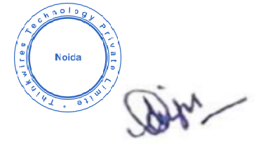

# INTRODUCTION

**Thinkwires Technology Pvt Ltd** is a company incorporated under the laws of India, having its registered office at PLOT NO: 20, BLOCK- H-1/A, SECTOR - 63, NOIDA-201301, India \[Hereinafter referred to as **“We” or “Us” or “Company” or “THINKWIRES TECHNOLOGY PVT LTD”\].**

In accordance with all applicable laws, THINKWIRES has created this Privacy Policy \[Hereinafter referred to as **“Privacy Policy”** or **“Policy”** or **“Privacy Statement”**\] in order to demonstrate **THINKWIRES TECHNOLOGY PVT LTD’s** privacy commitment to any individual whose data THINKWIRES collects, stores or processes for providing or offering its services and products.

# DEFINITIONS

**Employs**: Any individual or entity which has a contractual relationship with THINKWIRES, where THINKWIRES is the principal and the other individual or entity is the agent, shall hereinafter be referred to as an "EMPLOYS". For instance, THINKWIRES’s Employs, Vendors, contractors, etc. shall be considered.

**Data** **Subject:** All individuals whose personal information is either collected, received, processed, stored, dealt or handled by THINKWIRES shall hereinafter be referred to as “Data Subject”.

**Information:** Personal Information of a Data Subject collected by THINKWIRES under this Policy shall hereinafter be referred to as “Information”. Such Information includes, interrail, Sensitive Personal Data or Information as defined under the Indian Information Technology Act, 2000 and after amendment IT Amendment Act 2008.

**Third-Party:** Any individual or entity over which THINKWIRES does not have any control or ownership, and which operates independently on its own is hereinafter referred to as a "Third Party".

# GOVERNING LAW

Thinkwires is an organization based and existing in India and is thus bound by the laws of the Republic of India. This Privacy Policy has been prepared in accordance with applicable Indian laws, including the Indian Information Technology Act, 2000 and after amendment IT Amendment Act 2008 have specific data protection clauses section 43A holds a corporate responsible towards the sensitive personal data (which is clearly defined) it collects and deals with and outlines the liabilities organizations carries. The liability includes compensation to an individual for any damages caused by any wrongful use of the individual’s data.

**Section** **43** **A:** Where a body corporate possessing, dealing or handling any sensitive personal data or information in a computer resource which it owns, controls or operates, is negligent in implementing and maintaining reasonable security practices and procedures and thereby causes wrongful loss or wrongful gain to any person, such body corporate shall be liable to pay damages by way of compensation to the person so affected.

Compensation for failure to implement reasonable security practices can be upto Rs. 5 Crores (the Adjudicating Officer has the power to award this). A data subject can further approach a civil court if compensation desired is more than Rs. 5 Crore.

**Section** **72A:** Save as otherwise provided in this Act or any other law for the time being in force, any person including an intermediary who, while providing service under the terms of lawful contract, has secured access to any material containing personal information about another person, with the intent to cause or knowing that he is likely to cause wrongful loss or wrongful gain discloses, without the consent of the person concerned, or in breach of a lawful contract, such material to any other person, shall be punished with imprisonment for a term which may extend to three years, or with fine which may extend to five lakh rupees, or with both.

# APPLICABILITY

This Policy applies to all individuals whose Information is either collected, received, processed, stored, dealt or handled by **Thinkwires Technology Pvt Ltd.**

# OBJECTIVE

This Privacy Policy is intended to inform the **Data** **Subject** on how **Thinkwires** collects, processes, stores, and uses personal information that a **Data** **Subject** provides to **THINKWIRES** either directly or indirectly**.** This Privacy Policy also covers **Thinkwires’s** treatment of any personal information that Third Parties share with **THINKWIRES**.

# HOW THINKWIRES COLLECTS DATA SUBJECT’S INFORMATION

**THINKWIRES** collects Information about **Data** **Subject** through the following means:

1)  whenever a **Data** **Subject** shows an interest or elects to use **Thinkwires’s** services or products, including information about THINKWIRES schemes, irrespective of whether such services/products are provided directly by **THINKWIRES** or by its Agents on **Thinkwires’s** behalf;

2)  through **Thinkwires’s** network of Agents and a Third Party which collects such Information and transfers it to **THINKWIRES** for a business requirement;

3)  when **Data** **Subject** downloads **Thinkwires’s** mobile applications or visits any of the websites owned by THINKWIRES and/or creates an account on the mobile applications or the websites.

4)  when **Data** **Subject,** which also includes employees of THINKWIRES, directly elects to share their Information with THINKWIRES.

# WHY THINKWIRES COLLECTS DATA SUBJECT’S INFORMATION \[PURPOSE\]

**THINKWIRES** uses the **Information** to conduct its business and to provide **Data** **Subject** with the best possible services/products. **THINKWIRES** will only use the **Information** based on this Privacy Policy, its understanding with the **Data** **Subject**, or as required by law.

**THINKWIRES** will collect adequate, relevant and necessary **Information** and will process such Information fairly and lawfully for the purpose it is collected . Most commonly, **THINKWIRES** will use the **Information** in the following circumstances:

1)  Where **THINKWIRES** needs to perform the obligations, it has promised the **Data** **Subject,** such as to

provide a service or product to the **Data** **Subject** and to enable the **Data Subject’s** use of **Thinkwires’s**

products/services, including but not limited to dealing with enquiries and complaints made by or about the **Data** **Subject** relating to services/products provided by **THINKWIRES** and to improve and customise **Thinkwires’s** services/products in accordance with the **Data Subject’s** preferences;

2)  Where **THINKWIRES** needs to comply with a legal, accounting, business or reporting obligation, including compliance with requests from the Government of India or any Governmental Agency;

3)  To send marketing as well as non-marketing commercial communications to the **Data** **Subject**;

4)  To send the **Data** **Subject** notifications that the **Data** **Subject** has specifically requested for as well as to send statements, invoices and payment reminders to the **Data** **Subject**, and to collect payments from the **Data** **Subject**;

5)  To provide Third Parties with statistical information about its customers but those Third Parties will not be able to identify any individual from that information;

6)  To keep **Thinkwires’s** website, mobile applications and other systems secure and to prevent fraud;

Thinkwires Technology Pvt Ltd.

7)  To promote the mission and objectives of Skill Development in India and/or to provide and disseminate information about relevant programmes under the Skill Development Mission.

8)  To manage the employment of the data subject with THINKWIRES.

THINKWIRES collects and processes the Information only when it is essential to offer its services/products to the Data Subject. By providing his or her Information, the Data Subject agrees that THINKWIRES may collect, use and share this Information with Third Parties for the purposes mentioned above from 7\[a\] to 7\[h\].

# FAILURE TO PROVIDE INFORMATION

**THINKWIRES** may not be able to perform the obligations it has promised the **Data** **Subject**, or **THINKWIRES** may be prevented from complying with its legal, accounting, business or reporting obligations if the **Data** **Subject** fails to provide certain Information when requested by **THINKWIRES**.

**THINKWIRES** shall not be held liable in any manner whatsoever if **THINKWIRES** is unable to perform its services or if there is a deficiency in **Thinkwires’s** services to the **Data** **Subject** due to **Data Subject’s** failure to provide such Information.

**THINKWIRES** and/or its Contractors, employees, directors, associates, etc. shall be indemnified by the **Data** **Subject** and held harmless from any complaints, legal proceedings or claims filed or initiated by the **Data** **Subject** or any Third Party against **THINKWIRES** in this regard.

# CHANGE OF PURPOSE

**THINKWIRES** will only use **Data Subject’s Information** for the purposes for which **THINKWIRES** collected it, unless **THINKWIRES** reasonably considers that it needs to use it for another reason and that reason is compatible with the original purpose.

# CONSENT

**Data** **Subject** agrees that **THINKWIRES** does not need any additional or further consent from **him/her** to use the **Data Subject’s Information** in accordance with this Policy to carry out **Thinkwires’s** legal obligations or exercise specific rights.

# INFORMATION SHARING AND DISCLOSURE

**THINKWIRES** may disclose the **Information** to any of its Agents or Third Parties insofar as reasonably necessary for the purposes set out in this Policy and for the purpose of providing services/products to the **Data** **Subject**.

Such Agents and Third Parties are expected to provide a similar level of protection to the **Information**

as is adhered to by **THINKWIRES**.

In addition to this, **THINKWIRES** may disclose the **Information** where it is required to do so by law or to Governmental Agencies. Thinkwires Technology Pvt Ltd

# TRANSFER OF INFORMATION OUTSIDE INDIA

Unless stated otherwise, **THINKWIRES** stores and processes the **Information** in India. There may, however, be occasions when **THINKWIRES** needs to transfer the **Information** outside India for its business requirements. In such instances, **THINKWIRES** will exercise the same level of care in handling the Information as it does in India.

# DATA SECURITY

The **Information** is processed by **THINKWIRES** in strict accordance with the Indian Information Technology Act, 2000 after amendment IT 2008 Act, and the rules notified.

# DATA RETENTION

**THINKWIRES** will only retain the **Information** for as long as necessary to fulfil the purposes **THINKWIRES** collected it for, including for the purposes of satisfying any legal, business, accounting, or reporting requirements.

In some circumstances, **THINKWIRES** may anonymize the **Information** so that it can no longer be associated with the **Data** **Subject**, in which case **THINKWIRES** may use such information without a further reference to **Data** **Subject**.

# WHO HANDLES AND RETAINS DATA SUBJECT’S INFORMATION

Details about the primary entity which handles and retains the **Information** is provided below:

**Thinkwires Technology Pvt Ltd** having its registered office at:

PLOT NO: 20, BLOCK: H-1/A, SECTOR: 63, NOIDA-201301. INDIA

# REVIEW OF INFORMATION

**Data** **Subject** can contact **THINKWIRES,** through the Grievance Officer whose details are provided at the end of the Policy, requesting access to **Data Subject’s Information** for reviewing or requesting amendment to certain information that **Data** **Subject** considers to be incorrect or wrong. **THINKWIRES** shall process such requests from **Data** **Subject** in accordance with applicable law.

**THINKWIRES** shall not be responsible for the authenticity of the **Information** provided by the **Data** **Subject** to **THINKWIRES** or its Agents. Thinkwires Technology Pvt Ltd.

# WITHDRAWAL OF CONSENT

**Data** **Subject** may at any time revoke or withdraw **Data Subject’s** consent to provide **Information** to

**THINKWIRES** by contacting the Grievance Officer whose details are provided at the end of the Policy. However, such action may render it difficult for **THINKWIRES** to offer some of its services/products to the **Data** **Subject** any further.

**THINKWIRES** shall not be held liable in any manner whatsoever if **THINKWIRES** is unable to perform its services or if there is a deficiency in its services to **Data** **Subject** due to **Data Subject’s** withdrawal of consent.

**THINKWIRES** and/or its Agents, employees, directors, associates, etc. shall be indemnified by the **Data** **Subject** and held harmless from any complaints, legal proceedings or claims filed or initiated by the **Data** **Subject** or any Third Party against **THINKWIRES** in this regard.

# CHANGES TO THIS PRIVACY POLICY

The Policy is subject to modifications from time to time. If **THINKWIRES** decides to change this Policy, **THINKWIRES** shall publish the modified Policy on its website.

# GRIEVANCE OFFICER

In accordance with the Indian Information Technology Act 2000 after amendment IT Amendment Act 2008 and the rules notified thereunder, the contact details of the Grievance Officer are provided below:

Anju Data Protection Officer

Thinkwires Technology Pvt Ltd
